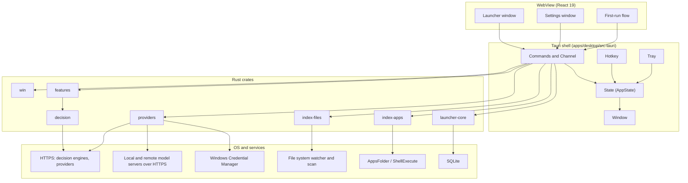

# Architecture

Flick is a free, open-source, keyboard-first Windows launcher with five prefixes in one bar: Open, Commands, Calc, Ask and Projects. The shell is Tauri 2 (ADR-001). All logic lives in Rust crates under `crates/`, and the Tauri app in `apps/desktop/src-tauri` is a thin layer that wires state, hotkey, tray and windows to those crates. The UI is React 19 and TypeScript, rendered by WebView2. The WebView makes no network calls; all HTTPS traffic (decision engines, providers, update check) is made from Rust. The Next.js site in `apps/web` is separate from the app.

## System diagram

Node count: 21 (3 UI, 5 shell, 7 crates including planned decision, 6 OS/services). The four subgraphs are containers, not nodes.

## Crates

| Crate | Responsibility | May use unsafe? |
| --- | --- | --- |
| `launcher-core` | Shared types, nucleo matcher wrapper, ranking hooks, SQLite store, config model, brand constants | No |
| `index-apps` | AppsFolder enumeration, filters, launch (normal, runas, reveal), icon extraction, app cache | Yes (SAFETY comments) |
| `index-files` | File index: scan, skip rules, filesystem watcher, snapshot persistence, query for the `files` source of Open (`/`) | No |
| `providers` | Provider trait, OpenAI-compatible and Anthropic clients, presets, local detection, fallback order, cancellation, secret store (ADR-011) | No |
| `decision` | NL parser, /v1/systemone client for Laya, Kev and Jev, LLM picker with strict JSON parsing | No |
| `features` | Feature trait, registry, settings schema, start/stop lifecycle (`TaskScope`), frecency, math, projects and other feature modules | No |
| `win` | Win32 and WinRT wrappers: power, session, recycle bin, Explorer restart, radios, media session, port tables, UI Automation | Yes (SAFETY comments) |

Workspace members (from `Cargo.toml`): `crates/launcher-core`, `crates/index-apps`, `crates/index-files`, `crates/providers`, `crates/decision`, `crates/features`, `crates/win`, `apps/desktop/src-tauri`. The Tauri app is a workspace member but is not a library crate, so it is not in the table above.

## Key flows

### Hotkey to visible

1. The hotkey plugin fires and the shell calls `tray::show_launcher`.
2. The launcher window was created at startup and hidden, so it is only shown, not built (ADR-001).
3. The UI reports shown through `report_shown`, and focus moves to the input.

### Keystroke to results

1. The UI parses the prefix (the `MODES` table in the launcher reducer, ADR-012) and sends the mode, the text and the source ids for that prefix through the `search` command.
2. Rust composes the results from those sources: apps, programs, files, and the enabled features named in the list.
3. The matcher (`nucleo-matcher`, ADR-004) scores the app list from `index-apps` and the file index from `index-files`.
4. Each enabled feature in the list runs its `query()` (synchronous, cheap, ADR-009).
5. Frecency boosts are added only when the Frecency feature is on, then results are ranked.

### Enter to launch

1. The UI calls `launch` with the selected item.
2. `index-apps` launches through `ShellExecuteExW` on `shell:AppsFolder\<parsing name>`; admin uses the `runas` verb and runs synchronously so a cancelled UAC prompt is reported (ADR-002).
3. The launch call has a 30 ms budget (project performance budgets).

### Query: ask_stream with fallback and cancel

1. The UI calls `ask_stream`; the shell returns an ask id and streams deltas over the event channel.
2. A `CancellationToken` is stored per ask id; `cancel_ask` cancels it.
3. The provider hub (`crates/providers/src/hub.rs`) tries enabled providers in the user's order and falls back to the next one on connection errors, timeouts, 429 and 5xx. Other errors (no key, host mismatch, insecure URL) stop the ask with an error.
4. All network calls are made in Rust, never from the WebView (ADR-011).

### Find: index (snapshot, then scan, then watch)

1. On start, `index-files` loads the persisted snapshot so Find works immediately.
2. A parallel `jwalk` scan of the default roots (and user-added roots) refreshes the index (ADR-003).
3. A `notify` watcher applies live changes after the scan.
4. Find queries match over the indexed paths.

### Feature toggle (start and stop)

1. The registry calls `start(ctx)` when a feature is enabled. The feature gets a `TaskScope`, a cancellable set of tasks, from the registry.
2. Turning the feature off calls `stop()`, which cancels the `TaskScope` and drops watchers, timers, caches and network clients (ADR-009).
3. A stopped feature holds no tasks, watchers, timers or network clients.

### A secret's lifecycle

1. The user enters a key in Settings; the UI calls `set_secret` once.
2. Rust wraps the value in `SecretString` and stores it in Windows Credential Manager through `keyring`, under a name built from provider id and host (for example `provider.openrouter@openrouter.ai`) (ADR-007, ADR-011).
3. For each request, Rust reads the secret from Credential Manager into a `SecretString` in memory.
4. The request goes only to the host the secret is bound to, over HTTPS.
5. No command returns the secret. The UI only receives `{present, last4, host, added_at, last_used}`. Secrets are never logged, panicked or written to config or SQLite.

## Where data lives

The paths below come from `crates/launcher-core/src/config.rs`. The app directory name is `<app>`, which is `brand::APP_DISPLAY_NAME` (code value: `Flick`). ADR-007 writes `<APP_NAME>`, which is `brand::APP_NAME` (code value: `flick`). The code uses the display name for these directories.

| Data | Location | Source |
| --- | --- | --- |
| Config (`config.toml`) | `%APPDATA%\<app>\config.toml` | `config_path()` |
| Caches: app list (`apps.json`), icons (`icons\<hash>-32.png`, `-64.png`), file index snapshot (`files.idx`) | `%LOCALAPPDATA%\<app>\cache\` | `local_data_dir()` |
| SQLite store (frecency, prefix learning, rate cache) | `%LOCALAPPDATA%\<app>\store.db` | `state.rs` (`Store::open`) |
| Logs | `%LOCALAPPDATA%\<app>\logs\app.log` | `logging.rs` |
| API keys and OAuth tokens | Windows Credential Manager (DPAPI, per Windows user) | ADR-011 |

## Decision records

- [ADR-001 Shell and UI](adr/ADR-001-shell-and-ui.md)
- [ADR-002 App index](adr/ADR-002-app-index.md)
- [ADR-003 File index](adr/ADR-003-file-index.md)
- [ADR-004 Matching](adr/ADR-004-matching.md)
- [ADR-005 Natural-language finder](adr/ADR-005-natural-language-finder.md)
- [ADR-006 Providers](adr/ADR-006-providers.md)
- [ADR-007 Storage and secrets](adr/ADR-007-storage-and-secrets.md)
- [ADR-008 Repo and web](adr/ADR-008-repo-and-web.md)
- [ADR-009 Feature modules](adr/ADR-009-feature-modules.md)
- [ADR-010 Integrations](adr/ADR-010-integrations.md)
- [ADR-011 Secret security](adr/ADR-011-secret-security.md)
