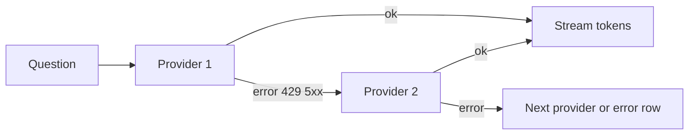

# Flick: Product Requirements Document

| Field | Value |
|---|---|
| Document | 01-PRD |
| Version | 1.0 |
| Date | 19 Oct 2026 |
| Owner | Akshit Bansal |
| Status | Draft |

## What this document is for

This document says what Flick must do and how we will know it works. The builder (Akshit) and the AI agents use it. Every requirement has an ID so tests and reviews can point to it. The build order is in `06-Implementation-Plan.md`.

## Summary

- Flick is a wrapper. It ships no model, no key, no account and no default provider. Every feature works with no paid account.
- It is a free, open-source (MIT), keyboard-first Windows 11 launcher with three modes in one bar: Command, Find and Query.
- It feels instant: the window is created once and only shown and hidden (50 ms or less at p95).
- Ten features sit behind PowerToys-style toggles. Off means stopped: no CPU, no network.
- v0.0.1 ships the core and F01 to F05. v0.1.0 ships F06 to F10.

## 1. Problem

| Tool | Where it falls short |
|---|---|
| Windows Search (Win+S) | Slow to open. Mixes web results and ads into the list. Does not learn which app you mean for "s". |
| PowerToys Run | Good, but many people already use Alt+Space for it. No natural-language file search, no explain-this-text, no local-model support. |
| Win+R | Exact commands and paths only. No fuzzy matching, no Store apps by name. |

Flick fixes this with one bar, fuzzy matching on everything, ranking that learns, and optional AI that the user connects.

## 2. Vision and principles

**Vision:** one bar to any app, file, answer or action in a few keystrokes, sending no data anywhere you did not choose.

| Principle | In practice |
|---|---|
| Instant | The window is prewarmed. Matching never uses the network. |
| Keyboard-first | Every action has a key. |
| FOSS-first | Free and local options come first. The user decides what to connect; nothing AI-related is on out of the box. |
| Private | No telemetry, no sign-in. Keys sit in Credential Manager and never return to the UI. AI engines see file names only. |
| Modular | Each feature has a toggle. Off stops it completely. |

## 3. Target users

**Dev (Arjun, 24).** Has 30 repos under `D:\dev`. Wants `code kite` and `port 3000`. Already runs Ollama.

**Gamer and power user (Mehak, 21).** Many small apps. Wants one letter per app, media keys for any player, Wi-Fi and Bluetooth toggles, and no RAM waste in games.

**Student on a budget (Rohan, 20).** No paid AI. Runs a small Ollama model or OpenRouter free models. Wants "explain this" and quick expense logging to Notion.

## 4. Goals and non-goals

**Goals:** replace Start search and PowerToys Run for daily use on Windows 11; meet every budget in section 11; work fully with local models only; let users toggle any feature at runtime.

**Non-goals:** telemetry, accounts or cloud sync; a plugin marketplace; macOS, Linux or Windows 10 builds; a bundled model (Flick never ships Laya, Ollama or weights); full-text search inside files; code signing or an auto-updater in v0.0.1 and v0.1.0.

## 5. Scope per release

| Release | Contents |
|---|---|
| v0.0.1 | Hotkey window, M-CMD, M-FIND, M-QUERY, Tab and prefix switching, feature system, Settings, tray, single instance, launch at startup, first run, F01 to F05, unsigned NSIS installer. |
| v0.1.0 | F06 to F10, Decision engine and Integrations settings pages. |
| Later ideas | Window switcher, clipboard history, Everything SDK as a Find backend, auto-updater, code signing, winget package, more themes. Not promised. |

## 6. Modes

All three modes share one input. The right end shows the mode name and "Tab" (hint-only switcher). Tab and Shift+Tab cycle modes. Typing `>`, `/` or `?` as the first character switches to Command, Find or Query and removes the character.

### 6.1 M-CMD: Command mode (always on)

Command mode finds apps, runs commands and shows feature results. It cannot be turned off.

**Stories:** I type `spo` and press Enter to open Spotify. With an empty bar I see my most-used apps.

| ID | Requirement | Acceptance |
|---|---|---|
| FR-CMD-01 | Match typed text against installed apps exactly as Start "All apps" lists them, Store apps included. | Spotify from the Store is found by `spo`. |
| FR-CMD-02 | App entries only. Never folders, documents, uninstallers or help links. | An app named "Uninstall X" never appears. |
| FR-CMD-03 | Enter launches. Ctrl+Shift+Enter runs as admin. Ctrl+Enter opens the app location. | Each key runs its action once. |
| FR-CMD-04 | Empty input shows the most-used apps. | With history, the top 5 show. |
| FR-CMD-05 | Show up to 5 one-line results. Up and Down move the selection. | A sixth match scrolls, never grows the bar. |
| FR-CMD-06 | Feature results (math, web, system, projects) share the same list. | `2+2` shows `4` above app matches. |
| FR-CMD-07 | Load apps from cache at start. Refresh every 10 minutes and on demand. Launch never waits for the app (NFR-06). | Cold start never waits for enumeration. |

### 6.2 M-FIND: Find mode

Find mode searches files and folders under the indexed roots. It has a toggle. Off stops the index and the watcher.

**Story:** I type `/budget` and open my budget sheet.

| ID | Requirement | Acceptance |
|---|---|---|
| FR-FIND-01 | Fuzzy-match file and folder names. | A typo still finds the file. |
| FR-FIND-02 | Default roots: Desktop, Documents, Downloads, Pictures, Videos, Music, plus user roots. | A file in a user root is found. |
| FR-FIND-03 | Skip `node_modules`, `.git`, `target`, `dist`, `build`, `.next`, `AppData`, `$Recycle.Bin`, hidden and system entries. | None appear. |
| FR-FIND-04 | The selected result shows actions: Open (Enter), Open file location (Ctrl+Enter, `explorer /select`), Copy path (Ctrl+C). | Each works from the keyboard. |
| FR-FIND-05 | Keep a live index (file watching) and a persisted snapshot. Match 300,000 paths in 25 ms or less at p95 (NFR-05). | After restart, results show before any scan ends. |
| FR-FIND-06 | Turning Find off drops the index, watcher and snapshot loader. | Memory returns near baseline in 5 seconds. |

### 6.3 M-QUERY: Query mode

Query mode asks an AI model and streams the answer. It has a toggle. Off means Flick makes no AI calls at all.

**Story:** I type `?what is a mutex` and read the answer as it arrives.

| ID | Requirement | Acceptance |
|---|---|---|
| FR-QRY-01 | Stream the answer from the first enabled provider that responds. | The first token paints on arrival. |
| FR-QRY-02 | On connection error, HTTP 429 or 5xx, fall back to the next enabled provider in the user's order. | With provider 1 stopped, provider 2 answers. |
| FR-QRY-03 | A Fast/Think toggle sits in the bar. It is hidden when the provider has no reasoning control. | Shown only where supported. |
| FR-QRY-04 | No history by default. Nothing is written to disk. | After restart, no past question exists. |
| FR-QRY-05 | Esc cancels the stream and aborts the HTTP request. | The request closes within 100 ms. |
| FR-QRY-06 | The bar grows to fit the answer up to 60% of the monitor height, then scrolls inside. | A long answer never exceeds 60%. |
| FR-QRY-07 | The system prompt asks for direct, brief answers. Markdown is allowed. `max_tokens` is 1024. | Checked in a recorded request fixture. |
| FR-QRY-08 | With no provider enabled, show the empty state "Connect a model to ask questions" with a button to AI providers settings. Command and Find work fully with no AI. | No crash, no network call. |

### 6.4 Window, hotkey and tray (all modes)

| ID | Requirement | Acceptance |
|---|---|---|
| FR-WIN-01 | Alt+Space (configurable) toggles a frameless, always-on-top window, centered at 28% from the top of the monitor under the mouse cursor. | On a second monitor, it opens there. |
| FR-WIN-02 | Create the window once at startup, keep it hidden, never destroy it. | The same handle survives 50 toggles. |
| FR-WIN-03 | Hide on Esc (a second press, after the first clears input), on focus loss, and after a successful launch. | Each trigger hides it. |
| FR-WIN-04 | Show with a 100 ms fade and 0.98 to 1 scale. Nothing animates on keystroke. Reduced motion turns it off. | Checked with reduced motion on. |
| FR-WIN-05 | Tray icon with Open, Settings and Quit. Single instance: a second launch opens the existing window. | No second process stays alive. |
| FR-WIN-06 | Launch at startup is a toggle in General. **Decision:** off by default, to avoid surprises. | The toggle writes and removes the startup entry. |
| FR-FRS-01 | First run asks for the hotkey. If registration fails (for example PowerToys Run owns Alt+Space), say so and ask for another. | A simulated conflict shows the prompt. |
| FR-FRS-02 | First run probes local ports and offers detected servers; the user turns on what they want (FR-AI-02). A one-time overlay teaches Tab and the `>` `/` `?` prefixes. | The overlay shows once. |

## 7. Features

Each feature is a module behind one trait, with a toggle in Settings. A toggle applies instantly. Off calls `stop()` and drops watchers, timers, caches and network clients. Config: `[features.<id>] enabled = true` plus options.

### F01 Frecency ranking (v0.0.1)

**What:** ranks by how often and how recently you used something (frecency). It also learns per typed prefix. **Example:** `s` opens Spotify (42 uses this week); `sl` opens Slack. **Story:** as a user, I want one letter to be enough for my top apps.

| ID | Requirement | Acceptance |
|---|---|---|
| FR-F01-01 | Exponential decay with a 7-day half-life. | A use today counts double a use 7 days ago. |
| FR-F01-02 | Remember which item was chosen for each typed prefix. | After choosing Slack for `sl` twice, it ranks first. |
| FR-F01-03 | Final rank is match score plus frecency and prefix bonus. Off means pure match order. | A strong text match beats a stale favorite. |

**Options:** half-life (7 days), prefix learning on or off, clear history.

### F02 Inline math and units (v0.0.1)

**What:** results while you type in Command mode (fend-core, chrono-tz, ECB rates). **Examples:** `2.5 kg to lb` gives `5.512 lb`; `250 usd in inr`; `5pm ist in pst`. **Story:** as a user, I want conversions without opening a browser.

| ID | Requirement | Acceptance |
|---|---|---|
| FR-F02-01 | Arithmetic and units run offline. | `2.5 kg to lb` works with the network off. |
| FR-F02-02 | Time zones use chrono-tz. | `5pm ist in pst` gives the right time and day. |
| FR-F02-03 | Currency uses the ECB daily XML, fetched at most once a day, off the keystroke path, then cached. | Typing never triggers a request. |
| FR-F02-04 | Offline uses the last cache and shows its age ("rates 3 days old"). Enter copies the result. | Network off shows the age. |

**Options:** currency refresh on or off.

### F03 System commands (v0.0.1)

**What:** Lock, Sleep, Hibernate, Restart, Shut down, Sign out, Empty Recycle Bin, Restart Explorer, Wi-Fi on/off, Bluetooth on/off (Windows.Devices.Radios). **Example:** `restart`, Enter, Enter. **Story:** as a gamer, I toggle Bluetooth without opening Settings.

| ID | Requirement | Acceptance |
|---|---|---|
| FR-F03-01 | Restart, Shut down, Sign out and Empty Recycle Bin need Enter twice within 3 seconds. | A second Enter after 4 seconds does nothing. |
| FR-F03-02 | Lock, Sleep, Hibernate and Restart Explorer run on one Enter. Wi-Fi and Bluetooth rows show the current state; if radio access is denied, show why. | Row says "Wi-Fi: on". |

**Options:** confirm window (3 s), which commands are shown.

### F04 Web shortcuts (v0.0.1)

**What:** a keyword plus text opens a URL template with `{q}`. **Example:** `yt lofi beats` opens the YouTube search. **Story:** as a user, I want `amz` to search amazon.in.

| ID | Requirement | Acceptance |
|---|---|---|
| FR-F04-01 | Defaults: g (Google), yt (YouTube), gh (GitHub), amz (amazon.in), maps (Google Maps), wiki (Wikipedia). | All six exist on a fresh install. |
| FR-F04-02 | Query text is URL-encoded into `{q}`. Users add, edit, remove and reorder shortcuts. | `a&b` becomes `a%26b`. Changes need no restart. |

**Options:** the shortcut list.

### F05 Project launcher (v0.0.1)

**What:** finds dev folders and opens them in an editor or terminal. **Example:** `code kite` opens `D:\dev\kiteloom` in VS Code; `term kite` opens Windows Terminal there; `kite` opens the folder. **Story:** as a developer, I want to jump into any repo by name.

| ID | Requirement | Acceptance |
|---|---|---|
| FR-F05-01 | A project is a folder with `.git`, `package.json`, `Cargo.toml`, `pyproject.toml` or `go.mod`, under the dev roots (default `D:\dev` and `%USERPROFILE%\source\repos`, when they exist). | Each marker is found in a fixture tree. Missing roots are skipped. |
| FR-F05-03 | Also list recent VS Code workspaces from VS Code's own state store. Verify its location on the machine before coding. | A recent workspace outside the roots appears. |
| FR-F05-04 | Keywords `code <name>`, `term <name>`, and a bare name. Editor is selectable: VS Code (default), Cursor, Zed or a custom command. | Each opens once. |

**Options:** roots, editor, keywords.

### F06 Natural-language finder (v0.1.0)

**What:** plain-English file requests in Find mode. An offline parser goes first. A decision engine helps only when needed (ADR-005). **Example:** `open my pfp from pictures` opens `pfp_2026.png`. **Story:** as a user, I want to describe a file, not remember its name.

| ID | Requirement | Acceptance |
|---|---|---|
| FR-F06-01 | Runs on Enter in Find mode when input has 3+ words or a marker (my, from, in, the, that, last, yesterday). Never on the keystroke path. | Typing never calls an engine. |
| FR-F06-02 | Stage 1, always on and offline: strip filler, map locations, file types and time words to filters, then fuzzy-match. | The 40+ phrase test suite passes. |
| FR-F06-03 | If the top score is above the threshold and 10% or more ahead of the second, open it. | A clear result opens with no engine call. |
| FR-F06-04 | Stage 2 sends the top 8 candidates (file name and parent folder only) as one Choice question to the first enabled, reachable engine. Act at p 0.6 or higher; otherwise show choices. | A fixture with p 0.55 shows choices. |
| FR-F06-05 | Engine order: Laya, Kev, the user's Query provider (strict JSON), Jev. Cache input to chosen item. With all engines off, the parser and choices list still work. | Works with the network off. |

**Options:** engine toggles and order, candidates (8), threshold (0.6).

### F07 Ports and processes (v0.1.0)

**What:** shows what holds a TCP or UDP port and can kill it. **Example:** `port 3000` shows `node.exe, PID 18244, 312 MB, up 2h 14m`; `proc chrome` lists processes. **Story:** as a developer, I want to free a stuck port in two keys.

| ID | Requirement | Acceptance |
|---|---|---|
| FR-F07-01 | `port <n>` lists processes holding that port: name, PID, memory, uptime, command line. | A test listener is shown. |
| FR-F07-02 | `proc <name>` searches running processes. | A partial name matches. |
| FR-F07-03 | Backspace kills the selected process after a confirm. Access denied shows "needs admin". | No kill without the confirm. |

**Options:** confirm before kill (on).

### F08 Media controls (v0.1.0)

**What:** play, pause, next, previous and now-playing on any player through Windows media controls. No account. **Examples:** `next`; `play lofi beats on spotify`; `play lofi on youtube`. **Story:** as a gamer, I skip a track without leaving the game.

| ID | Requirement | Acceptance |
|---|---|---|
| FR-F08-01 | Use Windows Global System Media Transport Controls. Shows now-playing. Works for Spotify and browser YouTube. | Pause works on a playing browser tab. |
| FR-F08-03 | `play <x> on spotify` opens `spotify:search:<x>` in the desktop app. `play <x> on youtube` opens the YouTube search in the browser. | Both links open. |
| FR-F08-04 | Optional Spotify connection: OAuth PKCE with the user's own client ID. When connected, `play <song>` starts it directly. | Fixture token flow passes. |
| FR-F08-05 | Optional YouTube Data API key opens the first result. Tokens and keys live in Credential Manager. | Without a key, the search page opens. Config has no secrets. |

**Options:** Spotify client ID, YouTube key, default service.

### F09 Explain this (v0.1.0)

**What:** a second hotkey grabs selected text in any app and opens Query mode with it attached. **Example:** select 14 lines in VS Code, press Alt+Shift+Space. **Story:** as a student, I want to ask about code without copy and paste.

| ID | Requirement | Acceptance |
|---|---|---|
| FR-F09-01 | Hotkey Alt+Shift+Space (configurable), with conflict detection as in FR-FRS-01. | A taken key is reported. |
| FR-F09-02 | Grab text with UI Automation TextPattern first, then a simulated Ctrl+C with clipboard save and restore. | The clipboard is unchanged. |
| FR-F09-03 | Show the captured text before anything is sent. | Nothing is sent until I press Enter. |
| FR-F09-04 | Block text that looks like a secret (key patterns, long high-entropy tokens), per FR-SEC-08. | A fake `sk-...` key is blocked. |

**Options:** hotkey, preview (on), secret blocking (on, cannot be turned off).

### F10 Quick capture (v0.1.0)

**What:** one line into Obsidian, a Markdown file, Notion or a webhook. **Example:** `log 250 lunch` offers "Add to Money Tracker" and "Append to daily note". **Story:** as a student, I log an expense in five seconds.

| ID | Requirement | Acceptance |
|---|---|---|
| FR-F10-01 | Parse inputs like `log 250 lunch` locally. | Amount and label are found offline. |
| FR-F10-02 | Obsidian and plain Markdown: append to today's daily note or a chosen file by writing the file directly. No plugin. | The file gains one line. |
| FR-F10-03 | Notion: internal integration token plus database ID, fields mapped to properties. | Recorded fixture passes. |
| FR-F10-04 | Webhook: POST JSON to a URL. | Fixture receives the JSON. |
| FR-F10-05 | Ask the Query provider only when the format is unclear. Secret-looking text is blocked (FR-SEC-08). | Clear input makes no AI call. |

**Options:** targets, vault folder, file path, Notion token and database, webhook URL.

## 8. Settings and toggles

A separate window with the same tokens. Left navigation: General, Features, AI providers, Decision engine, Integrations, About.

| ID | Requirement | Acceptance |
|---|---|---|
| FR-SET-01 | General: hotkeys, theme (follow Windows, dark, light), launch at startup, indexed roots, clear history. | Each persists. |
| FR-SET-02 | Features page: a Modes group (Command locked on, Find, Query) and a Features group. Each row has icon, name, version tag, description, Options button, pill toggle. | Command toggle is disabled. |
| FR-SET-03 | The nav shows the count switched on (for example 9/10). | Count updates on toggle. |
| FR-SET-04 | Options pages are generated from each feature's `settings_schema()`. Toggles apply instantly and call `start()` or `stop()`. | A new feature needs no hand-written UI. No restart. |
| FR-SET-05 | Config is TOML at `%APPDATA%\flick\config.toml`. Frecency and caches are SQLite. | Invalid TOML falls back to defaults and keeps a backup. |
| FR-SET-06 | Decision engine page: Built-in parser (locked on, not a model), Laya, Kev, Your AI provider, Jev. The four models are all off until the user enables one. Each has a toggle, probe status and options. A note explains `laya-serve`. | A fresh install has only the parser on. |
| FR-SET-07 | Integrations page: Spotify (with steps to make a developer app), YouTube, Obsidian, Notion, webhooks. | Secrets go to Credential Manager. |
| FR-SET-08 | About: version, license, links to repo, docs, changelog. | Links open. |

## 9. AI providers and FOSS-first

| ID | Requirement | Acceptance |
|---|---|---|
| FR-AI-01 | One Provider trait with two wire formats: OpenAI Chat Completions and Anthropic Messages. | Both pass recorded SSE fixtures. |
| FR-AI-02 | Probe the three local ports with `GET /v1/models` (200 ms timeout) on first run and on demand, and offer the models found. | Fake servers on the ports are listed. |
| FR-AI-03 | Presets in order: Ollama (`localhost:11434/v1`), LM Studio (`localhost:1234/v1`), llama.cpp server (`localhost:8080/v1`), OmniRoute (`localhost:20128/v1`), OpenRouter, Anthropic, OpenAI, Custom. Detected servers are offered, never enabled for the user. No provider is preselected or recommended as default. | Settings list this order. A fresh install has no provider enabled. |
| FR-AI-04 | Settings group providers as Local, Free gateways, Your own key. Secret handling follows section 10. | See FR-SEC. |
| FR-AI-05 | Fast/Think maps to each provider's own control. For Anthropic claude-haiku-5-5, never send temperature, top_p, top_k or an assistant prefill. Current docs are fetched before coding. | Request fixture has none of them. |
| FR-AI-06 | Laya, Kev and Jev share one `/v1/systemone` client with a base URL and optional bearer key. Laya is never bundled. | One client serves all three. |
| FR-AI-07 | Every feature works with zero paid accounts. | The release checklist runs with no keys set. |

## 10. Security and secrets

This covers every secret: provider keys, the Notion token, the YouTube key, Spotify tokens and webhook secrets. It becomes ADR-011.

| ID | Requirement | Acceptance |
|---|---|---|
| FR-SEC-01 | Store secrets in Windows Credential Manager through `keyring` (DPAPI, per Windows user). Never in `config.toml`, SQLite, logs, crash output, exports or backups. | A file scan after a full run finds no secret. |
| FR-SEC-02 | Keys are write-only from the UI. The WebView sends a key once through a dedicated Tauri command and Rust stores it. No command returns a secret. The UI gets only `{present, last4, host, added_at}`. | No command output holds a secret. |
| FR-SEC-03 | All network calls run in Rust, never in the WebView. CSP: `default-src 'self'`, `connect-src ipc:` only, no remote scripts, frames or images. Minimal Tauri capabilities: no shell, fs, http or opener beyond need. | A WebView fetch fails. |
| FR-SEC-04 | Model output is untrusted. Render Markdown with raw HTML off, no remote images. Links open only on click. Output never triggers an action. | An answer with `` and `<script>` shows as text and makes no request. |
| FR-SEC-05 | In memory, secrets use `secrecy::SecretString` and `zeroize`. They are not `Debug` or `Display`, and drop right after the request is built. | Formatting a secret prints a mask. |
| FR-SEC-06 | A key is bound to the host it was entered for. It is sent only over HTTPS to that host (plain http only for `localhost` and `127.0.0.1`). Changing the base URL host requires entering the key again. Authenticated requests never follow redirects. | A redirect is not followed. A host change clears the key. |
| FR-SEC-07 | A logging redaction layer masks key patterns and every stored secret value. The panic hook redacts too. | A logged key and a panic message appear masked. |
| FR-SEC-08 | Explain this and Quick capture block text that looks like a secret from being sent. | A fake key in either flow is blocked with a reason. |
| FR-SEC-09 | CI runs cargo-deny, cargo-audit and `pnpm audit`. Lockfiles are committed. Releases carry SHA-256 checksums. | CI fails on a known advisory. |
| FR-SEC-10 | Each key has a Delete button (removes it from Credential Manager), a Test key button and a "last used" time. | Delete removes the entry. Test reports ok or the error. |
| FR-SEC-11 | State residual risk in the README and the warning: malware as the same Windows user can read Credential Manager; a compromised provider or extension can leak a key. | Text in both places. |
| FR-SEC-12 | Mandatory warning (below) appears in the "Add key" dialog every time a secret is added or replaced. Save stays disabled until the checkbox is ticked. Providers without a key (local) never show it. | No tick, no Save. Replacing a key shows it again. Ollama never shows it. |

**Warning text, shown exactly:** "Your key is stored in Windows Credential Manager and is only sent to *host*. No storage is completely safe: malware on your account, a compromised extension or a breach at the provider could still expose it. Add it at your own risk. Before saving, set a spending or usage limit in your provider's dashboard, and use a key created only for Flick so you can revoke it on its own."

**Checkbox:** "I understand the risk and have set a usage limit."

## 11. Non-functional requirements

| ID | Requirement | Target |
|---|---|---|
| NFR-01 | Hotkey to window visible | p95 50 ms or less (`scripts/measure.ps1`, 50 toggles) |
| NFR-02 | Command match, 2,000 apps, all v0.0.1 features on | 2 ms or less per query (criterion) |
| NFR-03 | Keystroke to painted results | p95 16 ms or less |
| NFR-04 | Each feature's `query()` | 0.5 ms or less (criterion per feature) |
| NFR-05 | Find match over 300,000 synthetic paths | p95 25 ms or less |
| NFR-06 | Enter to launch call returned | 30 ms or less, never waits for the app |
| NFR-07 | Cold start to tray ready, with caches | 600 ms or less |
| NFR-08 | Idle RAM including WebView2 | 120 MB or less; CPU near 0% |
| NFR-09 | All features off | Nothing polls; no timers, watchers or network clients |
| NFR-10 | Query token paint | Each token painted on arrival, no buffering |
| NFR-11 | Privacy | No telemetry. No network on the keystroke path. Decision engines get file names and folders only. |
| NFR-12 | Security | All of section 10 (FR-SEC). `unsafe` only in `index-apps` and `win`, each block with a `// SAFETY:` comment. |
| NFR-13 | Accessibility | Listbox and option roles, visible focus, full keyboard use, text contrast at least 4.5:1 in both themes, reduced motion respected |
| NFR-14 | Reliability | A failing feature never crashes the launcher. Errors show as a row. Invalid config falls back to defaults. |
| NFR-15 | Install size | **Decision:** installer 15 MB or less (Tauri uses the system WebView2). |
| NFR-16 | Windows support | Windows 11 (22H2 and later), x86_64. Windows 10 is not tested. |
| NFR-17 | Toggle latency | **Decision:** a toggle takes effect within 200 ms. Logs are local, rotate at 5 files of 1 MB, and hold no secrets or typed text. |

## 12. Success metrics

Flick has no telemetry, so metrics come from scripts, tests and the owner's own use.

| Metric | Target | How measured |
|---|---|---|
| Performance budgets | All NFR-01 to NFR-08 met at each release | Benches and `measure.ps1`, recorded in `docs/performance.md` |
| Keystroke network | 0 calls | Request counter while typing 1,000 keys |
| Dogfood | Akshit uses Flick as the only launcher for 14 days | Personal log |
| Free-only run | 100% of F01 to F10 pass with no paid keys | Release checklist |

## 13. Risks and mitigations

| Risk | Impact | Mitigation |
|---|---|---|
| Laya has weak zero-shot accuracy and gets worse with many options | Wrong file opens | The offline parser goes first. Only 8 candidates are sent. Act only at p 0.6 or higher. Engines are off by default. |
| Spotify Premium and a 5-user dev-mode limit (since Feb 2026) make a shared client ID impossible | Direct play cannot be shipped for everyone | The base layer needs no account. Spotify connection is optional and uses the user's own client ID, with steps in Settings. |
| Unsigned installer triggers SmartScreen | Users distrust the download | README explains the prompt. Each release has a SHA-256 checksum. Signing is a later item. |
| Alt+Space conflicts with PowerToys Run | Hotkey fails silently | First run detects the failed registration and asks for another key. |
| Malware as the same Windows user, a bad browser extension or a provider breach exposes a key (residual risk, FR-SEC-11) | Key theft and spend | Write-only keys, host binding, mandatory warning, usage-limit advice, delete button. Documented, not hidden. |
| WebView2 RAM pushes idle past 120 MB | Budget missed | Measure early (W5). One prewarmed window, Settings loaded lazily. If still over, record it and decide before release. |

## 14. Open questions

1. Final product name. "Flick" is a placeholder; renaming touches only the brand constants and `tauri.conf.json`.
2. Where does VS Code store recent workspaces on this machine? Verify before coding F05 (FR-F05-03).
3. Is the Laya `/v1/systemone` schema as documented today? Fetch the docs before coding.
4. Everything SDK as an optional Find backend later?
5. Is a free code-signing program available for this project?
