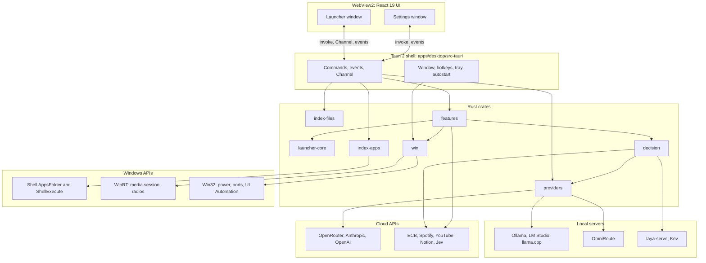

# Flick: Technical Requirements Document

| Field | Value |
|---|---|
| Document | 02 Technical Requirements Document (TRD) |
| Version | 1.0 |
| Date | 19 Oct 2026 |
| Owner | Akshit Bansal |
| Status | Draft |

## What this document is for

This document says how Flick is built and what the build must achieve: platform, architecture, technology, limits, security, testing and release. It is for the developers and agents who write the code. It follows KICKOFF.md, the ADRs and the 19 Oct security update (ADR-011). Where those are silent, this document decides and marks it "**Decision:**".

## Summary

- Flick is a Tauri 2 app for Windows 11 x64. All logic is in Rust crates. The React 19 UI runs in WebView2, holds no business logic and makes no network calls.
- One window is created at startup, kept hidden, and only shown or hidden. This keeps hotkey-to-visible under 50 ms (p95).
- Every feature is a module behind one trait. Off means stopped: no task, watcher, timer or network client stays alive.
- Flick is a wrapper: it ships no model, key, account or default provider. The user decides what to connect.
- Secrets live only in Windows Credential Manager and are write-only from the UI. There is no telemetry.

## 1. Platform and environment

| Item | Requirement |
|---|---|
| OS | Windows 11 x64 (22H2 or newer). Windows 10 is not supported (section 12). |
| Web view | WebView2 Runtime (Evergreen), present on Windows 11. Not bundled. |
| Rust | Stable toolchain pinned in `rust-toolchain.toml`, target `x86_64-pc-windows-msvc`. |
| C toolchain | MSVC Build Tools (`link.exe`, Windows 11 SDK). GNU toolchain not supported. |
| Node and pnpm | Node 20 or newer. A pnpm workspace beside the Cargo workspace, one repo. |
| Scripts | PowerShell (`scripts/release.ps1`, `scripts/measure.ps1`). |
| Output | One unsigned NSIS installer (SmartScreen prompt, noted in the README). |

**Decision:** the installer installs per user, without admin rights. Reason: a launcher should not need elevation to install; admin is a per-launch action.

## 2. Architecture overview

The UI never touches Windows or the network. It calls Tauri commands, receives events and reads streamed text from a channel. The Tauri shell is thin: it owns the window, hotkeys and tray, and calls the crates.


## 3. Technology choices

| Component | Choice | Why | Rejected |
|---|---|---|---|
| Shell | Tauri 2 | Small, Rust backend, WebView2 present, shortcut and tray plugins. | Electron (breaks the 120 MB budget). egui, iced, Slint (ADR-001). |
| UI | React 19 + Vite + TypeScript | Fast route to the design; pure reducer is easy to test. | Svelte, Solid (React is the owner's stack). |
| Fuzzy match | `nucleo-matcher` | Fast, from Helix, ASCII fast path. | `fuzzy-matcher` (slower). |
| Scan | `jwalk` | Parallel walk, skip rules by callback. | `walkdir` (single thread). NTFS USN journal (needs admin). Everything, Windows Search (external). |
| Watching | `notify` | `ReadDirectoryChangesW`, no polling. | Timed rescans. |
| Storage | `rusqlite` (bundled) | One file, SQL. | `sqlx` (async not needed). `sled`. |
| Secrets | `keyring`, `secrecy`, `zeroize` | Credential Manager, no own crypto, no printable secrets. | DPAPI file. Plain config (forbidden). |
| HTTP | `reqwest` (rustls) + small SSE parser | Byte streams, cancel by drop. Parser is about 60 lines. | `ureq` (blocking). SSE crates. |
| Windows APIs | `windows` | Official Win32 and WinRT bindings. | `winapi` (unmaintained). `windows-sys` (no COM or WinRT helpers). |
| Math, units | `fend-core` | Units and arithmetic offline. | `meval`, `evalexpr` (no units). |
| Time zones | `chrono-tz` | Full IANA database. | `jiff` (KICKOFF names chrono-tz). |
| Processes | `sysinfo` | Name, memory, start time, command line. | Raw Toolhelp (more `unsafe`). |
| Website | Next.js on Vercel | Locked by ADR-008. | Astro, Docusaurus. |
| Changelog | `git-cliff` | Regex rules map the owner's commit prefixes to sections. | `release-please` (strict Conventional Commits). |
| Release | `tauri-action` | Builds NSIS, attaches to a GitHub release. | Hand-written bundler steps. |

**Decision:** supporting crates are `tokio`, `tokio-util`, `serde`, `toml`, `thiserror`, `tracing`, `quick-xml` (ECB XML), `rayon`, `arc-swap`, `async-trait`, `criterion`, `wiremock`. Reason: small and common.

## 4. Crates

Dependencies point downward; `launcher-core` and `win` are the bottom layer. The shell (`apps/desktop/src-tauri`) may use every crate and is the only place for `anyhow`.

### 4.1 launcher-core

- **Does:** `brand.rs`, shared types, prefix parsing, nucleo wrapper, ranking hooks, secret detector, SQLite store, config model.
- **May depend on:** std, `serde`, `toml`, `rusqlite`, `nucleo-matcher`, `thiserror`.
- **May not depend on:** other workspace crates, `tokio`, `reqwest`, `windows`.

```rust
pub fn parse_prefix(raw: &str, current: Mode) -> (Mode, &str);
pub fn top_k(m: &mut Matcher, q: &str, hay: impl Iterator<Item = &str>, k: usize) -> Vec<Scored>;
pub fn looks_secret(text: &str) -> Option<SecretKind>;
```

### 4.2 win

- **Does:** Win32 and WinRT wrappers: power and session, recycle bin, Explorer restart, radios, media session, port tables, UI Automation text, clipboard. `unsafe` allowed, each block with `// SAFETY:`.
- **May depend on:** `windows`, `thiserror`.
- **May not depend on:** other workspace crates. It returns plain Rust types.

```rust
pub fn set_radio(kind: RadioKind, on: bool) -> Result<(), WinError>;
pub fn selected_text() -> Result<Captured, WinError>; // UIA first, Ctrl+C fallback
```

### 4.3 index-apps

- **Does:** enumerate `FOLDERID_AppsFolder`, ADR-002 filter, launch (normal, `runas`, reveal), icons (32 and 64 px), cache. `unsafe` allowed.
- **May depend on:** `launcher-core`, `windows`, `png`, `serde`, `thiserror`.
- **May not depend on:** `features`, `providers`, `decision`, `index-files`.

```rust
impl AppIndex {
    pub fn refresh_blocking(&self) -> Result<RefreshStats, AppsError>; // run in spawn_blocking
    pub fn entries(&self) -> Arc<Vec<AppEntry>>;
}
pub fn launch(e: &AppEntry, how: LaunchKind) -> Result<(), AppsError>;
```

### 4.4 index-files

- **Does:** scan, ADR-003 skip rules, live updates, compact list, snapshot load and save, query.
- **May depend on:** `launcher-core`, `jwalk`, `notify`, `rayon`, `arc-swap`, `thiserror`.
- **May not depend on:** `windows`, `win`, `tokio`, `features`, `providers`. Plain synchronous code; the shell wraps it.

```rust
impl FileIndex {
    pub fn scan(&self, roots: &[Root], cancel: &AtomicBool) -> Result<ScanStats, FilesError>;
    pub fn watch(&self, roots: &[Root]) -> Result<WatchHandle, FilesError>;
    pub fn query(&self, q: &FindQuery) -> Vec<FileHit>;
}
```

### 4.5 providers

- **Does:** `Provider` trait, OpenAI-compatible and Anthropic clients, presets, local detection, fallback order, key lookup, host binding, cancellation.
- **May depend on:** `launcher-core`, `reqwest`, `tokio`, `tokio-util`, `keyring`, `secrecy`, `zeroize`, `serde_json`, `thiserror`.
- **May not depend on:** `features`, `decision`, `win`, `index-*`.

```rust
#[async_trait] pub trait Provider: Send + Sync {
    fn stream(&self, req: Request, cancel: CancellationToken) -> BoxStream<'static, Result<Delta, ProviderError>>;
    async fn probe(&self) -> ProbeResult;
}
pub struct Auth { pub host: String, pub key: Option<SecretString> }
```

### 4.6 decision

- **Does:** stage 1 natural-language parser, `/v1/systemone` client (Laya, Kev, Jev), LLM picker, `DecisionEngine` trait.
- **May depend on:** `launcher-core`, `providers` (LLM picker only), `reqwest`, `tokio`, `secrecy`, `serde_json`, `thiserror`.
- **May not depend on:** `features`, `win`, `index-files`. It receives candidates as plain structs.

```rust
pub fn parse_nl(input: &str, now: DateTime<Local>, roots: &RootMap) -> ParsedQuery;
#[async_trait] pub trait DecisionEngine: Send + Sync {
    async fn choose(&self, q: &ChoiceQuestion) -> Result<ChoiceAnswer, EngineError>;
}
```

### 4.7 features

- **Does:** `Feature` trait, registry, settings schema, `FeatureCtx`, and the ten feature modules (one folder each).
- **May depend on:** `launcher-core`, `index-apps`, `index-files`, `providers`, `decision`, `win`, `tokio`, `reqwest`, `fend-core`, `chrono-tz`, `sysinfo`.
- **May not depend on:** Tauri or `apps/desktop`. A feature never imports another feature; shared needs come through `FeatureCtx`.

```rust
impl Registry {
    pub async fn apply_config(&self, cfg: &Config, ctx: &FeatureCtx);
    pub fn query_all(&self, input: &Input) -> Vec<Item>;
    pub async fn set_enabled(&self, id: &str, on: bool) -> Result<(), FeatureError>;
}
```

## 5. Process and threading model

| Thread or pool | What runs there |
|---|---|
| Main thread | Tauri event loop and Win32 message pump: hotkeys, tray, window show and hide. Never blocks. |
| Tokio runtime (Tauri's) | Commands, provider streams, HTTP, timers, registry toggles. |
| `spawn_blocking` | COM and shell work (enumeration, icons, `ShellExecuteExW`), disk scans, snapshot writes, SQLite, WinRT `.get()`, UI Automation. |
| Rayon pool | `jwalk` scan and parallel scoring for Find. |
| Store thread | Owns the SQLite write connection and takes write messages. Reads use a second read-only connection. |

Rules:

- Tauri commands are `async fn`. A sync command would run on the main thread.
- Each COM job calls `CoInitializeEx` first and `CoUninitialize` last, through a guard type.
- `search` runs Command matching inline (at most 2 ms of CPU). Find runs in `spawn_blocking` (25 ms budget).
- Each search carries a sequence number. The UI ignores old results; the backend skips work when a newer request has arrived.
- Background tasks belong to their feature or mode in a `TaskScope` (a `CancellationToken` plus a `JoinSet`). Disabling the owner cancels the scope and waits up to 500 ms.

**How the window shows fast.** The launcher window is created in setup with `visible(false)`, no decorations, always on top, no taskbar entry, solid background. React mounts at once and the page stays loaded. **Decision:** never call WebView2 `TrySuspend`; resume cost would hurt the 50 ms budget. On the hotkey:

1. Record `Instant::now()`.
2. Find the monitor under the mouse cursor (**Decision:** cursor monitor, as PowerToys Run does). Geometry is cached and refreshed on display change.
3. Set the position only if the monitor changed: centered horizontally, top edge at 28% of monitor height.
4. Call `show()` then `set_focus()`. If Windows refuses focus, retry once with a `win` helper that attaches to the foreground thread input.
5. Emit `launcher://shown`. The UI clears state, focuses the input, starts the 100 ms fade, then calls `report_shown`. The shell logs the elapsed time.

On hide, the UI resets to empty and the shell hides the window. The webview stays alive. **Decision:** Settings is created on first open and destroyed on close. Reason: a second live webview costs RAM.

## 6. Performance budgets

These are acceptance criteria. Measured numbers go in `docs/performance.md`.

| Budget | Limit | How it is measured |
|---|---|---|
| Hotkey to window visible | p95 <= 50 ms | Shell logs `Instant` at hotkey and `report_shown`. `measure.ps1` sends Alt+Space 50 times with `SendInput`, prints p95. |
| Command match, 2,000 apps, all v0.0.1 features on | <= 2 ms | Criterion bench `pipeline` in `crates/features`, real registry. |
| Keystroke to painted results | p95 <= 16 ms | Dev builds record `performance.now()` at keydown and after paint. |
| Each feature `query()` | <= 0.5 ms | One Criterion bench per feature. |
| Find match, 300,000 paths | p95 <= 25 ms | Criterion bench in `index-files`; a script reads raw samples for p95. |
| Enter to launch call returned | <= 30 ms | Log `Instant` around `ShellExecuteExW`. Never wait for the launched app. |
| Cold start to tray ready | <= 600 ms | Process creation time to the "tray ready" log line, 10 runs. |
| Idle memory | <= 120 MB with WebView2 | After 60 s idle, sum private working set of the app and `msedgewebview2` children. |
| Idle CPU | near 0% | CPU time over 30 s, limit 0.5%. |
| All features off | nothing polls | Unit test: every `TaskScope` reports 0 active tasks. |
| Query streaming | each token painted on arrival | Timed fixture stream; no batching timer. |

## 7. Security and privacy

### 7.1 Principles

- **No default provider.** Flick ships no model, key or account, and nothing AI-related is enabled. First run detects local servers (Ollama, LM Studio, llama.cpp) and offers them. In the decision engine list only the built-in parser is on. Query mode with nothing enabled shows "Connect a model to ask questions" and a button to AI providers. Command and Find work fully without AI.
- **No telemetry.** No analytics, no crash upload. **Decision:** no automatic update check in 0.x. Reason: it is a network call the user did not ask for.
- **No network on the keystroke path.** A test runs the search pipeline with an HTTP client that panics if used.
- **Decision engines** (Laya, Kev, Jev, LLM picker) receive the phrase and at most 8 candidates as file name plus parent folder. Never contents, never other keys.
- **Guarded commands.** Restart, Shut down, Sign out and Empty Recycle Bin need Enter twice within 3 seconds. Rust enforces it: the first `run_system_command` returns a one-time token with an expiry, and only a second call with that token inside 3 seconds acts. Process kill works the same way and refuses PID 0, PID 4 and Flick's own PID. Admin launch uses `runas`, so Windows shows UAC.
- **URLs.** Webhooks and web shortcuts accept only `http` and `https`. Rust builds all URLs and percent-encodes queries.

### 7.2 Threat model

| We defend against | We cannot defend against |
|---|---|
| A key leaking through config, SQLite, logs, panics, exports or backups. | Malware running as the same Windows user. It can call Credential Manager and read process memory. |
| Script in the WebView (for example from model output) reading or sending a key. | A compromised provider or gateway leaking what it receives. |
| A key sent to the wrong host: edited base URL, redirect, plain http. | A malicious extension or clipboard reader active when the user pastes a key. |
| Secrets pasted into Explain this or capture and sent on. | Keyloggers, a WebView2 vulnerability, a user with no usage limit. |
| Model output that tries to act by itself. | A tampered installer if the user skips the SHA-256 check. |
| A vulnerable or tampered dependency. | |

### 7.3 Secret handling

This applies to every secret: provider keys, OpenRouter key, TypeSafe key, Notion token, YouTube key, Spotify tokens, webhook URLs. It overrides KICKOFF where they differ (ADR-011 records it).

| # | Requirement | How it is implemented | How it is tested |
|---|---|---|---|
| 1 | Storage only in Credential Manager | `keyring` (DPAPI, per Windows user). Config and SQLite hold no secret, only metadata (name, host, added_at, last_used). | Test saves a canary key (keyring mock store), then scans config, `store.db`, logs and cache for it. One ignored test uses the real store. |
| 2 | Write-only from the UI | Commands `set_secret`, `delete_secret`, `test_secret`, `list_secrets`. The list returns only present, last4, host, added_at, last_used. There is no `get_secret`. last4 is computed on demand, shown only for keys of 16 or more characters, never stored. | Test fails if any command name contains `get_secret` or `read_secret`. A serde test checks the list struct has no value field. |
| 3 | All network in Rust, minimal capabilities | CSP and capabilities in 7.4. | CI grep fails on `fetch(`, `XMLHttpRequest`, `WebSocket`, `EventSource` in `apps/desktop/src`. A test compares CSP and permissions with an allowlist. |
| 4 | Model output is untrusted | Markdown with raw HTML off and a sanitizer; `img` and `iframe` disallowed; links only `http`/`https`, opened by `open_link` after a trusted click. Delta text goes only to the UI, never to `execute()`. The LLM picker reply is parsed as one integer in range. **Decision:** automatic opening in natural-language Find skips executable and script types (`.exe`, `.bat`, `.cmd`, `.ps1`, `.msi`, `.lnk`, `.vbs`, `.js`); they go to the choices list for a manual Enter. Reason: a model must not start a program by itself. | Vitest renders `<script>`, remote `` and `javascript:` links and checks nothing loads or runs. Unit tests cover the skip list and out-of-range replies. |
| 5 | Secrets in memory | `secrecy::SecretString` with `zeroize`, no `Debug` or `Display`. The key is read from `keyring` when the request is built, set as a sensitive header, then dropped. | Compile-fail test (no printing). CI grep allows `expose_secret()` only in `crates/providers/src/auth.rs` and listed clients. |
| 6 | Host binding | Config stores `key_host` next to `base_url` per provider. A request is refused unless the URL host equals `key_host` and the scheme is https (http only for `localhost`, `127.0.0.1`, `::1`). Authenticated requests use a client with redirects off. Changing the host deletes the stored key and the provider shows "enter key again". | `wiremock` tests: redirect not followed; mismatch and remote http refused; host change removes the key. |
| 7 | Redaction in logs and panics | A redaction layer wraps the log writer. It masks key patterns (7.5) and fingerprints of every secret used this session (salted SHA-256 plus length, so the value is not kept). The panic hook uses the same function. | Canary logged through error and panic paths, then the log file is scanned. |
| 8 | Explain this and Quick capture block secrets | One detector in `launcher-core` used by both (7.5). | Table test, 30+ positive and negative samples. |
| 9 | Supply chain | CI runs `cargo deny check`, `cargo audit` and `pnpm audit --prod`. Lockfiles are committed, installs frozen. Releases carry SHA-256 files. | The CI jobs fail the build. Exceptions need a comment in `deny.toml`. |
| 10 | Delete, test, last used | `delete_secret` removes the entry. `test_secret` makes one cheap authenticated call to the bound host (such as `GET /v1/models`). `last_used` is written after each real use. | Mock-store and `wiremock` tests. |
| 11 | Residual risk | Stated in the Add key warning (7.6) and the README. | Manual dialog check in the release checklist. |

### 7.4 CSP and capabilities sketch

`tauri.conf.json`, `app.security`:

```json
{ "csp": "default-src 'self'; connect-src ipc: http://ipc.localhost; img-src 'self' icon: http://icon.localhost data:; font-src 'self'; style-src 'self' 'unsafe-inline'; script-src 'self'; object-src 'none'; frame-src 'none'; base-uri 'none'" }
```

Tauri 2 on Windows serves IPC from `http://ipc.localhost`, so it is listed. App icons come from a local `icon:` protocol handled in Rust. **Decision:** `style-src 'unsafe-inline'` stays because React sets inline styles; scripts stay on `'self'`.

`capabilities/launcher.json` (the Settings window has its own file with more commands):

```json
{ "identifier": "launcher", "windows": ["launcher"],
  "permissions": ["core:event:default", "allow-search", "allow-launch", "allow-reveal",
                  "allow-copy-path", "allow-ask-stream", "allow-cancel-ask", "allow-hide-launcher"] }
```

No shell, fs, http, opener or clipboard plugin is exposed to any window. App commands are listed in `build.rs` with `AppManifest`, so the launcher window cannot call `set_secret`.

### 7.5 Secret detection (Explain this and Quick capture)

A Rust check runs on capture, again inside `ask_stream`, and before every capture write or send. It blocks AWS key IDs (`AKIA`, `ASIA`), GitHub tokens (`ghp_`, `github_pat_`), `sk-` keys, Slack tokens (`xox`), JWTs, PEM private key blocks, `password=` style assignments, and any token of 32 or more characters with Shannon entropy above 4.0 bits per character. **Decision:** no override button. Reason: blocked means blocked; select less text instead.

### 7.6 Add key warning

Every time a secret is added or replaced, the dialog shows this text and a required checkbox. Save stays disabled until it is ticked. `set_secret` also takes `acknowledged: bool` and rejects `false`, so the rule holds even if the UI is wrong. Local providers without a key never show it.

> Your key is stored in Windows Credential Manager and is only sent to `<host>`. No storage is completely safe: malware on your account, a compromised extension or a breach at the provider could still expose it. Add it at your own risk. Before saving, set a spending or usage limit in your provider's dashboard, and use a key created only for Flick so you can revoke it on its own.
>
> [ ] I understand the risk and have set a usage limit.

### 7.7 Outbound calls

| Outbound call | When | What is sent |
|---|---|---|
| `GET /v1/models` on ports 11434, 1234, 8080 | First run, Settings open, probe button | Only the request. 200 ms timeout. Localhost. |
| Provider chat `POST` | Submit in Query mode, or confirmed Explain this | System prompt, your text, optional attached text. First working enabled provider only. |
| Decision engine `POST` | Enter in Find, only if stage 1 is ambiguous and an engine is on | Phrase and up to 8 name plus parent folder pairs. |
| ECB XML `GET` | At most daily, background, only if F02 is on | Only the request. |
| Spotify, YouTube | Only after you connect or add a key | Song or search text. YouTube key as URL parameter. |
| Notion, webhook | Only when you capture to that target | The parsed fields. |
| Engine or key test | Probe or test button | A small request to the bound host. |

## 8. Reliability and error handling

- **Provider fallback.** Query mode tries enabled providers in the user's order. It moves on after connection errors, timeouts before the first token, HTTP 429 and 5xx, and never retries the same provider. After the first token, a failure ends the answer with an error; it never switches provider silently. **Decision:** HTTP 400, 401, 403 and 404 do not fall back; the bar shows the provider name and message and points to Settings. Reason: a bad key or model name should be fixed, not hidden. A host mismatch (7.3 point 6) also stops, with a clear message.
- **Offline.** Command, Find and math work fully. Currency uses the last cache and shows its age. Query works with local servers; if none answers, the bar lists what failed. Natural-language Find falls back to the parser and plain choices. Spotify direct play falls back to the `spotify:` link.
- **Hotkey failure.** If registering Alt+Space fails (for example PowerToys Run owns it), the shell emits `hotkey://conflict`. First run asks for another key. Later runs still start, the tray works, and Settings opens on General with a banner. Same for the Explain this hotkey.
- **File snapshot corruption.** A snapshot has a magic number, version and CRC. If a check fails, delete it, show "indexing" and rescan. Command mode is never blocked.
- **SQLite corruption.** If the database fails to open or an integrity check, rename it to `store.db.corrupt-<timestamp>`, create a new one and emit `store://reset`. History is lost; the app keeps working.
- **Config errors.** If `config.toml` does not parse, rename it to `config.toml.bad-<timestamp>`, load defaults and show a notice. Writes use a temp file and atomic rename.
- **Feature panics.** The registry runs `query()` and `execute()` under `catch_unwind`. A panicking feature is marked Failed; the launcher stays usable.

## 9. Logging

- `tracing` with `tracing-subscriber` and `tracing-appender`. Folder: `%LOCALAPPDATA%\Flick\logs\`. Daily rotation, keep 7 files, delete older ones at startup.
- Default level `info`. `FLICK_LOG` sets a filter. Request bodies are never logged.
- A redaction layer (7.3 point 7) masks key patterns and used secret values before anything is written. `Authorization` and `x-api-key` headers are never logged. `reqwest` errors are logged with `without_url()`, because the YouTube key is a URL parameter.
- Query text, Explain this text and capture input are never logged, only lengths and timings. Timing lines use target `perf` for `measure.ps1`.
- The panic hook logs location and a redacted message. Panic messages must not format user text or keys.

## 10. Testing strategy

| Level | What | Tools |
|---|---|---|
| Unit | Prefix parsing, matcher, ranking, frecency decay, app filter, skip rules, NL parser (40+ phrases), secret detection, config, confirm tokens, redaction. | `cargo test` |
| Integration | Registry lifecycle (disabled feature holds zero tasks), snapshots, store, fallback order, host binding, command handlers, canary-key scans. | `cargo test`, temp dirs, keyring mock store |
| Recorded fixtures | SSE streams (OpenAI and Anthropic formats), `/v1/systemone`, Notion, ECB XML, Spotify and YouTube replies. Scrubbed of keys. | `wiremock` |
| Live | `#[ignore]`. Run only when the service exists. Print pass or skip, never a key. | `cargo test -- --ignored` |
| Benchmarks | Matcher, pipeline, Find over 300,000 paths, one per feature query. | `criterion` |
| UI | The keyboard reducer, mode switching, growth rules, Markdown sanitizing. | Vitest |

| Variable | Enables |
|---|---|
| `OLLAMA_URL` | Ollama stream and model list |
| `LAYA_URL`, `KEV_URL` | `/v1/systemone` tests (must be reachable) |
| `ANTHROPIC_API_KEY`, `OPENROUTER_API_KEY` | Anthropic and OpenRouter streams |
| `TYPESAFE_API_KEY` | Jev test |
| `NOTION_TOKEN` | Notion capture (with `NOTION_DATABASE_ID`) |

Manual release checks: multi-monitor and DPI, UAC launch, Store app launch, radio toggles, the Add key dialog.

## 11. CI/CD

**`ci.yml`** runs on push and pull request on `windows-latest`, in order:

1. Checkout, Rust toolchain, Rust cache, Node 20, `pnpm install --frozen-lockfile`.
2. `cargo fmt --check`, then `cargo clippy --all-targets -- -D warnings`, then `cargo test` (ignored tests skipped).
3. `pnpm typecheck`, `pnpm lint`, `pnpm test`, and the no-network-in-UI grep (7.3 point 3).
4. `cargo deny check`, `cargo audit`, `pnpm audit --prod`.
5. `pnpm --filter web build`.

Benchmarks do not run in CI (shared runners are noisy). They run on the owner's machine.

**`release.yml`** runs on tags `v*` on `windows-latest`. `tauri-action` builds the NSIS installer and creates the GitHub release. A PowerShell step writes `<installer>.sha256` with `Get-FileHash` and uploads it. Release notes come from `git cliff --latest`. Pin action versions and check their docs when writing the file.

**Versioning.** Semantic versions: 0.0.1 (core and F01 to F05), then 0.1.0 (F06 to F10). `scripts/release.ps1 <version>` sets the version in the Cargo workspace, `tauri.conf.json` and every `package.json`, runs `git-cliff`, commits and tags. `CHANGELOG.md` is never edited by hand. `cliff.toml` maps the prefixes feat/, fix/, up/, rem/, sm/, add/, add-p/, hide/, init/ to sections. Vercel builds `apps/web` separately.

## 12. Compatibility

- **DPI.** Per-monitor DPI aware (Tauri default). Sizes are logical pixels; position is computed in physical pixels with the target monitor's scale factor. Window width is 700 logical px (from DESIGN_CONFIG and the UI/UX brief), with a 16 px side margin on narrow monitors. The shell resizes the height when the UI reports new content height.
- **Multiple monitors.** The window opens on the monitor under the cursor. Geometry is recomputed at the next show if monitors changed.
- **Light and dark.** `tokens.css` defines both. The default follows Windows through `prefers-color-scheme`; Settings can force one with `data-theme` on the root element. The 100 ms fade is skipped under reduced motion.
- **Windows 10.** Not supported and not tested. Flick may simply work there, but a bug only seen on Windows 10 is closed as "won't fix". ARM64 and 32-bit are unsupported in v0.x.

## 13. External services

Local and self-hosted come first, paid last. No service is required for the core app, and none is enabled by default.

| Service | Used for | Auth | Required | Failure behaviour |
|---|---|---|---|---|
| Ollama | Query provider, LLM picker | None | Optional | Next provider. |
| LM Studio | Query provider | None | Optional | Same. |
| llama.cpp server | Query provider | None | Optional | Same. |
| OmniRoute | Query provider (free gateway) | Optional key | Optional | Same. |
| OpenRouter | Query provider (free models too) | API key | Optional | Fallback on 429, 5xx. |
| Anthropic | Query provider | API key | Optional, paid | Fallback on 429, 5xx. No temperature, top_p, top_k or prefill for Haiku 5.5. |
| OpenAI | Query provider | API key | Optional, paid | Fallback on 429, 5xx. |
| Laya, Kev, Jev (`/v1/systemone`) | Stage 2 of natural-language Find | Optional bearer key (Jev needs one) | Optional | Next engine, then plain choices. |
| ECB rates XML | Currency (F02) | None | Optional | Last cache, age shown. |
| Spotify Web API | Direct play after you connect | OAuth PKCE, your own client ID | Optional | Falls back to `spotify:search:` link. App owner needs Premium; development mode allows 5 users. |
| YouTube Data API | First result instead of search page | API key | Optional | Falls back to the YouTube search URL. |
| Notion API | Quick capture target | Internal integration token | Optional | Error in the bar. No silent retry. |

The implementer must read each service's current docs before coding against it, as CLAUDE.md requires. Request and response shapes in the BSD are illustrative.
