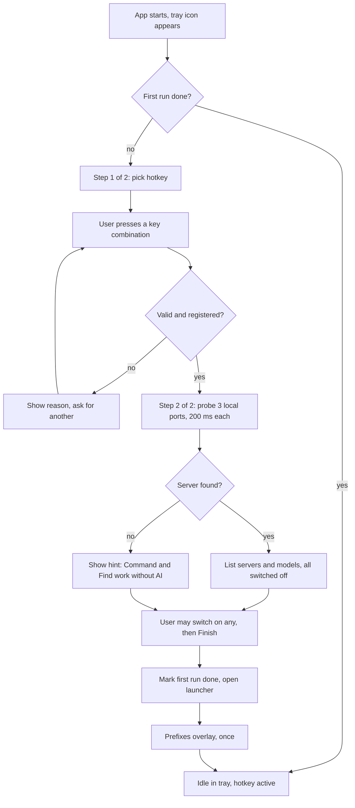
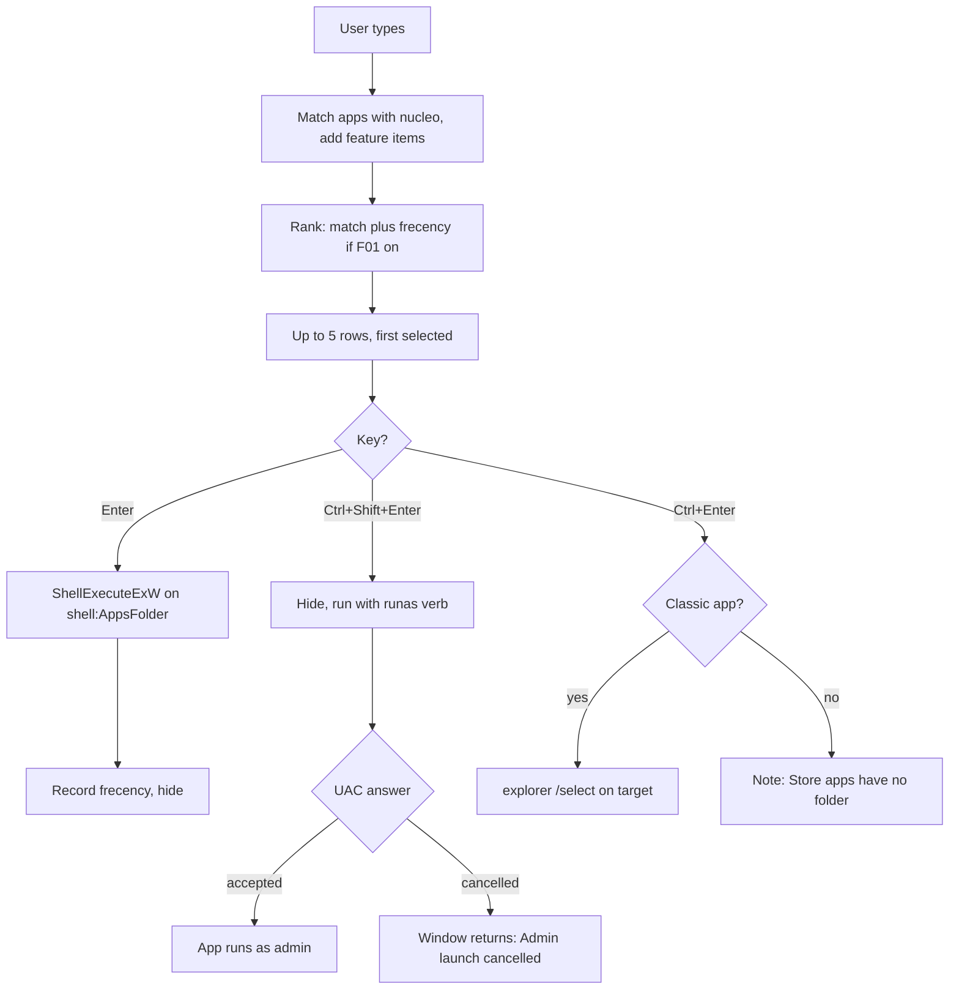
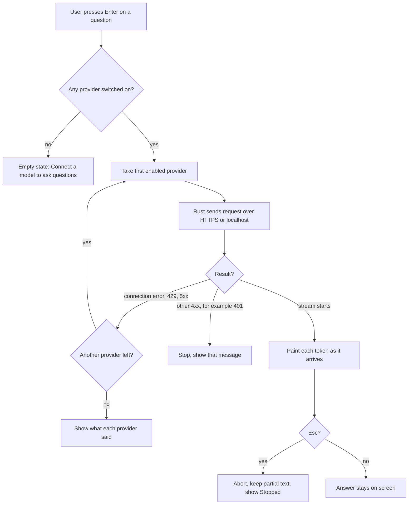
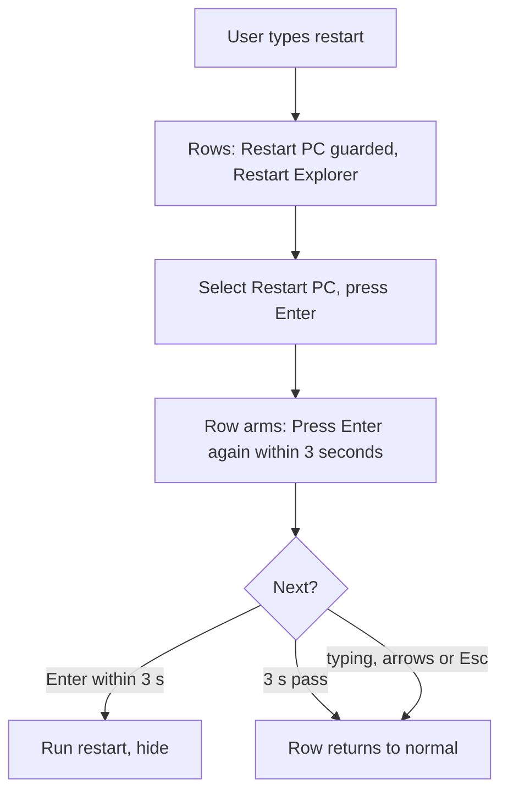
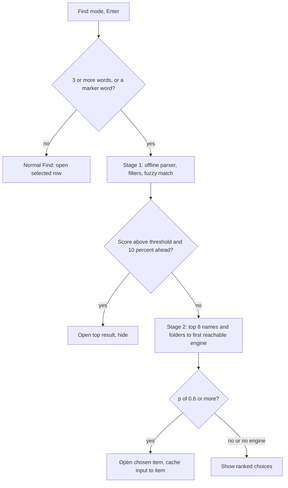
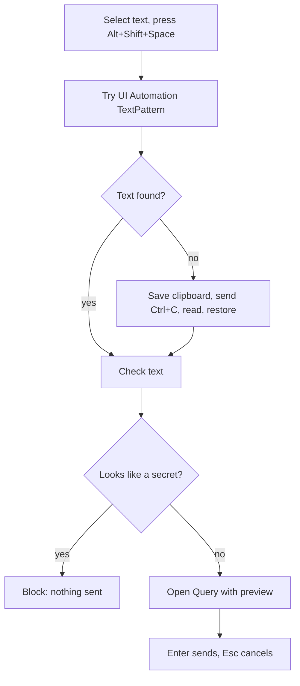
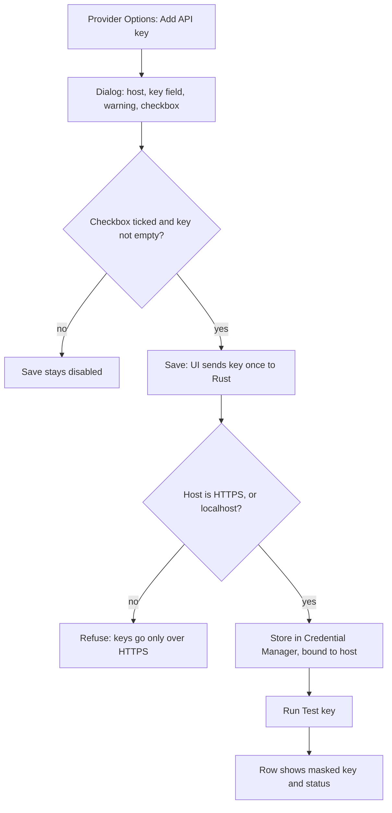

# Flick: App Flow Document

| Field | Value |
|---|---|
| Document | App Flow Document (AFD) |
| Version | 1.0 |
| Date | 19 Oct 2026 |
| Owner | Akshit Bansal |
| Status | Draft |

## What this document is for

This document describes every user journey in Flick, step by step: what the user does, what the app does, and what the user sees. Designers, developers and testers use it to check that every screen and state exists. Names and IDs (M-CMD, F01 and so on) match the other spec documents. It follows `KICKOFF.md` and the security update of 19 Oct, which wins where they differ.

## Summary

- Flick is a keyboard-first launcher with three modes: M-CMD (Command, always on), M-FIND (Find) and M-QUERY (Query).
- Flick is a wrapper. It ships no model, no key and no default provider. First run detects local servers and offers them; the user turns on what they want.
- Keys are added through one dialog with a mandatory risk warning, then stored in Windows Credential Manager. The UI can never read a key back.
- Features F01 to F10 are modules with a toggle. Off means stopped, with no restart.
- Every failure has a calm, defined state. Section 10 lists every screen with its states.

## How to read this document

Keys are in code style (`Enter`, `Ctrl+Enter`). Diamonds in flowcharts are decisions. **Decision:** marks a choice made where the sources are silent; section 11 lists them.

## 1. Install and first run

### 1.1 Installer

1. The user downloads the NSIS installer from the latest GitHub release, which shows a SHA-256 checksum.
2. SmartScreen may warn, because the installer is unsigned. The README says: "More info", then "Run anyway".
3. The installer copies the app, adds a Start entry and offers "Launch at startup".
4. **Decision:** per-user install, no admin prompt. A launcher needs no system-wide files.
5. The app starts and a tray icon appears. There is no main window.

### 1.2 First run

**Step 1: hotkey.** The field shows `Alt+Space`. The user keeps it or presses a new combination.

| Case | Message |
|---|---|
| No modifier | "Add Ctrl, Alt, Shift or Win." |
| Reserved by Windows (`Win+L`) | "Windows keeps this shortcut." |
| Registration fails | "Alt+Space is already used by another app. PowerToys Run is a common one. Pick another shortcut." The field stays in capture mode. |
| Same as the Explain this hotkey | "This shortcut is used for Explain this." |
| Works | Green "Shortcut works"; Next is enabled |

`Esc` cancels capture. "Skip" keeps the default if it registered; otherwise the tray menu is the only way to open Flick.

**Step 2: local servers.** Flick calls `GET /v1/models` on Ollama (11434), LM Studio (1234) and llama.cpp server (8080), 200 ms each. Each running server is offered as a row with its model names and a switch that is **off**. Nothing AI-related is on until the user turns it on. If none runs: "No local server found. Command and Find work without one. You can connect a model later in Settings." "Check again" re-probes.

**Prefixes overlay.** The first time the launcher shows, a card says: "Tab changes mode. Type `>` for Command, `/` for Find, `?` for Query." Any key dismisses it for good. The hint-only switcher hides these keys, so this card teaches them.

## 2. Open and close

**Open.** The user presses the hotkey. The prewarmed window moves to 28% from the top of the monitor under the mouse cursor, centered, and fades in over 100 ms (p95 to visible: 50 ms or less). Input is focused and empty. **Decision:** it always opens in Command mode; a predictable start beats a remembered one. Empty Command shows the five most-used apps (F01), or a hint if F01 is off. The tray icon and a second app launch also open it.

| Trigger | Result |
|---|---|
| Hotkey while visible | Hides |
| `Esc` while an answer streams | Cancels the stream, stays open |
| `Esc` with text in the input | Clears the input |
| `Esc` with empty input | Hides |
| Focus lost | Hides |
| Successful launch or open | Hides at once |

**Decision:** `Esc` follows one ladder: cancel stream, clear input, hide. That satisfies both "second Esc hides" and "Esc cancels the stream". On hide, input and answers are discarded; nothing is saved.

## 3. Mode switching

| Action | Result |
|---|---|
| `Tab` / `Shift+Tab` | Next / previous mode (Command, Find, Query) |
| `>` `/` `?` as first character | Switch to Command, Find, Query; character removed |

- Text stays when the mode changes: `spo`, then `Tab`, searches files for `spo`.
- A prefix works only as the first character; `a>b` stays literal. `>` in Command removes itself and stays.
- The input's right end shows the mode and hint (`Command · Tab`). The placeholder names the mode.
- **Decision:** a mode switched off is skipped by `Tab`, and its prefix types a normal character.

## 4. Command mode launch flow (M-CMD)

- Apps match Start "All apps", Store apps included. Folders, documents, uninstallers and help links never appear. Items from features share the list.
- `Enter` returns in 30 ms or less and never waits for the app.
- **Decision:** admin launch hides first and runs on a worker thread, because the UAC prompt can take seconds. A cancelled prompt brings the window back with the same query.
- **Decision:** open location is disabled for Store apps ("Store apps have no folder to open").
- Launch failure: the window stays open with "Could not start Spotify. Windows said: <message>. Press Enter to try again."
- No match: "Nothing matches "xyz". Press Tab to look in files instead."

## 5. Find mode flow (M-FIND)

1. The user presses `Tab` or types `/`. Each keystroke matches the in-memory index (25 ms or less over 300,000 paths). Up to 5 rows show a file-type tile, name and parent folder.
2. The selected row shows an action row:

| Item | Buttons | Keys |
|---|---|---|
| File | Open, Open file location, Copy path | `Enter`, `Ctrl+Enter`, `Ctrl+C` |
| Folder | Open folder, Open in Terminal, Copy path | `Enter`, `Ctrl+Shift+T`, `Ctrl+C` |

3. Open and location hide the window (location runs `explorer /select,<path>`). Copy path shows the toast "Path copied" and stays open.
4. **Decision:** `Ctrl+C` copies the path only with no text selected in the input, so normal copy keeps working. "Open in Terminal" comes from the Design Lab.
5. Empty input: hint "Type to find files and folders in 6 indexed folders" plus recent items from F01.
6. **Index building.** A cold start loads the saved snapshot, so results work at once. Without a snapshot, Find shows matches so far and "Still indexing: 41,200 files found."
7. Find off stops the index and watcher; `/` then types a normal character.

## 6. Query mode flow (M-QUERY)

1. The block shows the provider chip, the Fast or Think pill and the hint "Press Enter to ask. Nothing is saved."
2. The system prompt asks for direct, brief answers; `max_tokens` is 1024.
3. Flick tries the first enabled provider and falls down the user's order on connection errors, 429 and 5xx. **Decision:** 2 s connect timeout per provider, so a dead local server cannot stall the chain. Other 4xx errors stop the chain, as `KICKOFF.md` lists only three fall-through cases.
4. Tokens paint as they arrive, with a streaming cursor. The window grows up to 60% of monitor height, then the answer scrolls inside.
5. The chip shows who answered, for example `Ollama · qwen3:4b`.
6. Fast/Think toggles by click or `Ctrl+T`. It maps to the provider's reasoning control and is hidden if there is none.
7. `Esc` aborts. The partial answer stays with "Stopped." **Decision:** a stream that breaks after tokens arrived does not switch provider; it shows "Connection lost. Press Enter to try again."
8. After an answer, `Enter` asks again; typing clears it. **Decision:** `Ctrl+C` with no selection copies the answer; `Ctrl+P` or a chip click cycles provider.
9. **Untrusted output.** Markdown renders with raw HTML off, no remote images, and links open in the browser only on click. Model output never triggers an action.

**Nothing enabled.** The block says "Connect a model to ask questions" with a button "AI providers" (also `Enter`). A line below reads: "Local models are free. Command and Find work without AI." **Query off** in Settings skips the mode and stops all AI calls.

## 7. Feature flows (F01 to F10)

### 7.1 F01 Frecency ranking
The user launches an item after typing a prefix (`s`, then Spotify). F01 stores item, time and prefix in SQLite. Score decays with a 7-day half-life. Prefix learning remembers `s` led to Spotify and `sl` to Slack. Next time `s` ranks Spotify first; empty input shows the most used ("42× this week"). Off means pure match order; history stays until "Clear history" and a confirm ("Clear 1,204 records?").

### 7.2 F02 Inline math and units
1. The user types `2.5 kg to lb`, `250 usd in inr` or `5pm ist in pst`.
2. Each keystroke, fend-core checks the text (0.5 ms or less). A result row goes first, with a big result `5.512 lb` and the line `2.5 kg × 2.20462`.
3. Currency uses ECB daily rates, fetched at most once a day off the keystroke path.
4. `Enter` copies. The meta text becomes "Copied" and the window hides after 500 ms. **Decision:** copy is not a launch, so the pause confirms it.
5. Offline: last cached rate and "Rates from 14 Oct 2026, 4 days old". No cache: "No rates yet. Connect once to download them."

### 7.3 F03 System commands

Guarded: Restart, Shut down, Sign out, Empty Recycle Bin. Lock, Sleep, Hibernate, Restart Explorer, Wi-Fi and Bluetooth run on the first `Enter`. The first `Esc` while armed disarms the row and keeps the input. With no radio adapter the row is disabled: "No Wi-Fi adapter found."

### 7.4 F04 Web shortcuts
The user types `yt lofi beats`. The first row is "Search YouTube" with the query as subtitle; other engines follow. `Enter` encodes the text into the URL template, opens the default browser and hides. `yt ` alone shows "Search YouTube for…". Defaults: `g`, `yt`, `gh`, `amz` (amazon.in), `maps`, `wiki`; add, edit, remove, reorder in Options.

### 7.5 F05 Project launcher
`code kite` lists matching projects (`kiteloom`, `D:\dev\kiteloom`). `Enter` opens the editor (VS Code by default). `term kite` opens Windows Terminal there. A bare `kite` shows the folder with the apps. Projects are folders with `.git`, `package.json`, `Cargo.toml`, `pyproject.toml` or `go.mod` under dev roots, plus recent VS Code workspaces, scanned in the background at start.

### 7.6 F06 Natural-language finder

It runs on `Enter` only, never while typing. For `open my pfp from pictures`, stage 1 drops filler, maps "from pictures" to the Pictures root and runs the fuzzy match inside it. While it works, a muted line shows "Understood: Pictures · any type · name pfp". Stage 2 sends file names and parent folders only, to the first engine that is on and reachable: Laya, Kev, your Query provider, then Jev. All engines are off until the user enables one; the parser and choices list always work.

### 7.7 F07 Ports and processes
`port 3000` lists each process on that TCP or UDP port: `node.exe · next dev`, `PID 18244 · 312 MB · up 2h 14m`. `proc node` searches by name. The selected row shows `⌫ kill`. **Decision:** `Backspace` asks to kill only after the selection was moved with an arrow key; before that it edits text. The confirm reads "End node.exe (PID 18244)? Enter to end, Esc to cancel." If Windows refuses: "Could not end node.exe. It may need admin rights."

### 7.8 F08 Media controls

| Input | Without connection | With Spotify connected |
|---|---|---|
| `pause`, `next`, `previous` | Windows media session, any player, no account | Same |
| `play lofi beats`, Spotify row | Opens `spotify:search:lofi beats` in the desktop app. Subtitle: "Connect to start it directly." | Searches and starts it. No active device: opens the search link and says "Open Spotify once, then try again." |
| `play lofi beats`, YouTube row | Opens the search URL in the browser | With a YouTube key: opens the first result |

Spotify not installed: "Spotify is not installed." The YouTube row is one `Down` away.

### 7.9 F09 Explain this

1. The preview shows "Text from VS Code · 14 lines", the first 8 lines, and the receiver: "Will be sent to Ollama · qwen3:4b (this computer)" or "(cloud)".
2. The input takes an optional instruction; empty means "explain this".
3. **Decision:** at most 8,000 characters are sent, with a notice if cut.
4. Secret blocked: "This text looks like a secret (an API key pattern). Flick did not send it." No override.
5. No selection: "No text was selected. Select some, then press Alt+Shift+Space."
6. **Decision:** it needs Query on and a provider on; otherwise the hotkey opens the Query empty state.
7. The clipboard is always restored.

### 7.10 F10 Quick capture
1. The user types `log 250 lunch`. A local parser reads amount 250 and note "lunch". **Decision:** an editable keyword map gives the category (lunch is Food). `note <text>` appends raw text.
2. One row appears per enabled target: "Add to Money Tracker · ₹250 · Food · Notion", "Append to daily note · Obsidian".
3. `Enter` writes: a line appended to a Markdown file, a Notion page with mapped properties, or a JSON POST to a webhook. Toast "Added to Money Tracker", then hide.
4. Unclear format (`log lunch`): if a provider is on, only that line goes to it and the parsed row returns for confirmation. Otherwise: "Append as plain text".
5. Text that looks like a secret is blocked here too.
6. Failure keeps the window and input, with the cause. **Decision:** no offline queue in v0.1.0.

## 8. Settings flows

One Settings window, opened from the tray or a launcher link; a second open focuses it. Navigation: General, Features, AI providers, Decision engine, Integrations, About. General holds hotkeys, theme, launch at startup, indexed roots and clear history.

### 8.1 Toggle a feature
1. On Features, the user clicks a row's switch or presses `Space` on it.
2. **Off:** `stop()` runs and drops watchers, timers, caches and network clients. The next keystroke no longer shows it. The nav count falls from `10/10` to `9/10`. Explain this and Media also release hotkeys and listeners.
3. **On:** `start(ctx)` runs; slow work (project scan, ECB fetch) shows "Starting…" in the background.
4. No restart. Command is locked on. Find off stops the index; Query off ends all AI calls. Options stay editable while off.

### 8.2 Open Options
The row expands to fields built from `settings_schema()`: switches, numbers, text, choices, ordered lists (web shortcuts), folder lists (roots) and buttons (Clear history). Changes save at once to `config.toml`. The button reads "Hide".

### 8.3 Add an API key

1. The user opens Options on a provider that takes a key (OpenRouter, Anthropic, OpenAI, Custom) and presses "Add API key".
2. The dialog shows the host, a password field and this warning every time:

> Your key is stored in Windows Credential Manager and is only sent to <host>. No storage is completely safe: malware on your account, a compromised extension or a breach at the provider could still expose it. Add it at your own risk. Before saving, set a spending or usage limit in your provider's dashboard, and use a key created only for Flick so you can revoke it on its own.

3. Below it: a checkbox "I understand the risk and have set a usage limit." Save is disabled until it is ticked and the key is not empty. Local providers without a key never see this dialog.
4. On Save, the WebView sends the key once to Rust through a dedicated command. Rust stores it in Credential Manager and the UI gets back only `{present, last4, host, added_at}`. No command ever returns the key.
5. "Test key" calls `GET /v1/models` from Rust. Status: `Key works`, `Key rejected`, `Not reachable`.
6. The row then shows `•••• 4f2a · openrouter.ai · last used 2 h ago`, with Test key, Replace and Delete key.
7. **Replace** opens the same dialog, warning included. **Delete key** asks "Remove this key from Windows Credential Manager?" and clears it; the provider switches off.
8. **Changing the base-URL host** removes the saved key and asks for it again, with the warning. A change of path only keeps it. Authenticated requests never follow redirects.
9. The same dialog and rules apply to the TypeSafe (Jev) key, Notion token, YouTube key and webhook secrets.

### 8.4 Probe a provider
Local providers (Ollama, LM Studio, llama.cpp, OmniRoute) need no key: the user enters base URL and model, and Flick probes `GET /v1/models` (200 ms local, 5 s remote). Status: `Running · qwen3:4b` (green), `Not running`, `No key`, `Key rejected`, `Not set up`. The switch turns the provider on and the fallback number sets its place. Groups are Local, Free gateways, Your own key; none is preselected. **Decision:** "Check again" also probes OmniRoute's port.

### 8.5 Set up Laya
1. Decision engine page. Only the built-in parser is on. Laya, Kev, "Your AI provider" and Jev are off.
2. The Laya row note gives the steps: `pip install laya`, then `laya-serve`.
3. The user pastes the URL into Options (endpoint, optional key, 8 candidates, p of 0.6) and the probe turns `Running`.
4. **Decision:** no default URL is prefilled until the build task reads the Laya README.

### 8.6 Connect Spotify with your own client ID
1. Integrations, Spotify card, "Not connected". The card lists steps: open the Spotify developer dashboard, create an app, add the redirect URI shown, copy the client ID. Note: development apps need the owner on Premium and allow 5 users.
2. The user pastes the client ID (not a secret) and presses "Connect". The browser opens Spotify's login (PKCE).
3. Flick receives the code on a loopback address, exchanges it and stores the tokens in Credential Manager.
4. The card shows "Connected as <name> · last used 2 h ago" and a Disconnect button that deletes the tokens.
5. Failure: "Spotify did not connect. Check that the redirect URI matches exactly."

### 8.7 Connect Notion
The user pastes an integration token (through the Add key dialog) and a database ID. "Test" reads the schema; failures say "Notion said 401. Check the token." or "Database not found. Share it with your integration." A mapping step links Name, Amount, Category and Date. The database ID goes in `config.toml`.

### 8.8 Obsidian vault
The user picks the vault folder. **Decision:** Flick reads `.obsidian/daily-notes.json` for folder and date format, else uses the vault root and `YYYY-MM-DD.md`. The card shows "Will write to Daily/2026-10-19.md" or "Folder not found."

## 9. Error and edge flows

| Situation | User sees | App does |
|---|---|---|
| Offline, Query | Local providers still answer; remote ones are skipped | 2 s timeout, next provider |
| Offline, currency | Last rate with its age | No fetch until online |
| Provider 429 or 5xx | Nothing if another answers; chip shows who | Next provider |
| All providers failed | "No provider answered." plus one line each | Stays open; `Enter` retries |
| Provider 401 | "OpenRouter rejected the key (401). Check it in Settings." | Chain stops |
| Non-HTTPS key host | "Keys are only sent over HTTPS." | Request not sent |
| Redirect on keyed request | "The server redirected the request. Flick does not send keys to redirects." | Request stopped |
| Index still building | Partial results, "Still indexing" | Results grow |
| No results | "Nothing matches "xyz"." and the next step | None |
| Hotkey lost at startup | Tray note "Alt+Space is not available"; Settings banner | Tray Open works |
| Laya not running | Settings shows `Not running` | Next engine, else "No decision engine answered." |
| Spotify token expired | "Spotify needs you to connect again." | Uses the search link |
| Clipboard locked | "Could not read the selection." | Clipboard restored |
| Config broken | Tray note "Settings could not be read" | Defaults load; old file kept as `.bak` |

## 10. Screen and state inventory

| Surface | Empty | Loading | Results | Error | Disabled |
|---|---|---|---|---|---|
| Installer | n/a | Progress bar | Done page | "Setup failed" and log path | n/a |
| Tray menu | n/a | n/a | Open, Settings, Quit | Hotkey warning item | Open during first run |
| First run, hotkey | Default shown | "Checking…" | "Shortcut works" | Conflict message | Next until valid |
| First run, servers | "No local server found" | "Looking for local servers…" | Server rows, switches off | n/a | n/a |
| Prefixes overlay | n/a | n/a | One card | n/a | Never again |
| Launcher, Command | Five most used or hint | n/a | Up to 5 rows | Launch failed line | F01 off: no usage rows |
| Launcher, Find | Hint and recents | "Still indexing" | Rows, action row | "Could not open" | Find off: skipped |
| Find, plain English | n/a | "Understood: …" | Opened item or choices | "No decision engine answered" | Engines off: parser only |
| Launcher, Query | "Connect a model to ask questions" | Cursor, partial text | Answer block | Provider errors | Query off: skipped |
| Explain preview | "No text was selected" | "Reading selection…" | Text preview | Secret blocked | Needs Query on |
| Add key dialog | Empty field | "Testing…" | `Key works` | `Key rejected`, HTTPS refusal | Save until checked |
| Toast | n/a | n/a | One line | Error line | n/a |
| Settings, General | Defaults | n/a | Fields | Hotkey conflict | n/a |
| Settings, Features | n/a | "Starting…" | Mode and feature rows | Red row status | Off, dimmed |
| Settings, AI providers | All `Not set up` | "Checking…" | Rows with status | `Key rejected`, `Not running` | Off |
| Settings, Decision engine | Parser only | "Checking…" | Engine rows | `Not running` | Parser locked on |
| Settings, Integrations | "Not connected" | "Waiting for browser…" | "Connected", masked key | Connect failed | Needs Media on |
| Settings, About | n/a | n/a | Version, license, links | n/a | n/a |

## 11. Decisions made in this document

1. Per-user install.
2. Always open in Command with empty input.
3. One Esc ladder: stream, input, hide.
4. Modes switched off are skipped by Tab.
5. Admin launch runs on a worker thread; open location is off for Store apps.
6. `Ctrl+C` copies path or answer only with no selection. `Ctrl+T` is Fast/Think, `Ctrl+P` cycles provider, `Ctrl+Shift+T` opens a terminal.
7. 2 s connect timeout per provider, 5 s probe for remote hosts; no fall-through on 401 or a broken stream.
8. `Backspace` kills only after arrow selection.
9. Explain this: 8,000 characters, needs a provider, no secret override. Capture: keyword map, no offline queue.
10. Obsidian reads `daily-notes.json`. No Laya default URL until the README is read.
11. First-run servers are offered switched off, as ADR-006 and ADR-011 require.
