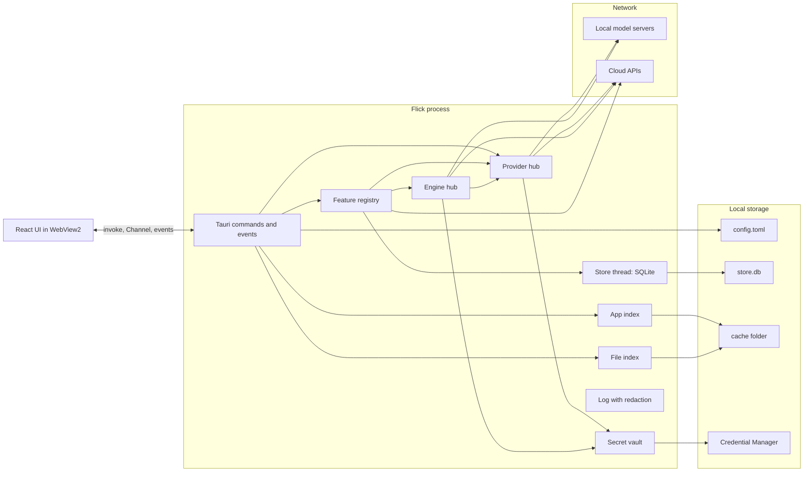
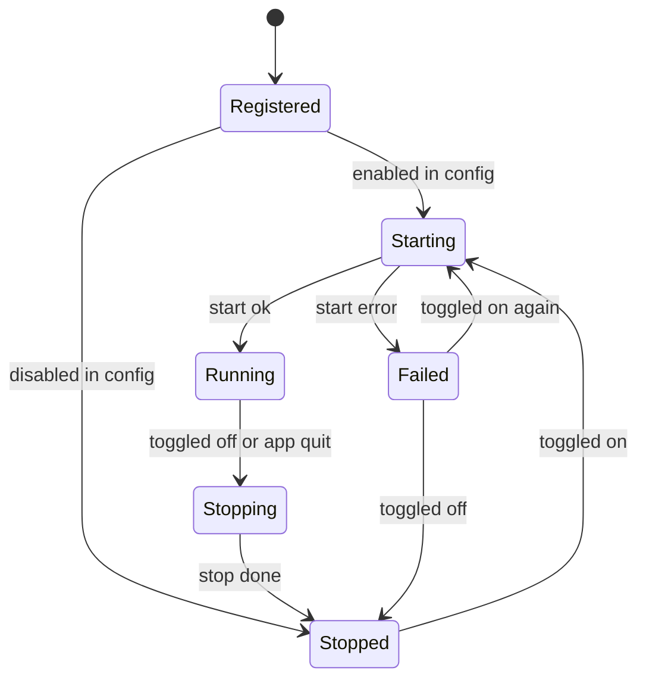

# Flick: Backend Structure Document

| Field | Value |
|---|---|
| Document | 05 Backend Structure Document (BSD) |
| Version | 1.0 |
| Date | 19 Oct 2026 |
| Owner | Akshit Bansal |
| Status | Draft |

## What this document is for

Flick has no server. Its "backend" is the Rust side of the app: crates, traits, Tauri commands, local storage and calls to outside services. This document defines those parts so executors can build them without guessing. Code blocks are sketches, not final code. The 19 Oct security update (ADR-011) applies: Flick is a wrapper, nothing AI is on by default, and secrets are write-only from the UI.

## Summary

- One Rust process holds everything: registry, indexes, store and provider hub. The UI talks to it only through Tauri commands, events and one streaming channel.
- Three traits carry the design: `Feature` (ADR-009), `Provider` (ADR-006) and `DecisionEngine` (ADR-005).
- Data lives in `config.toml` (settings), SQLite (history and caches), cache files (indexes) and Windows Credential Manager (secrets).
- Secret commands are write-only. No command returns a key. Each key is bound to the host it was entered for.
- Every background job has an owner and stops when the owner is turned off.

## 1. Overview



| Runs where | What |
|---|---|
| Main thread | Window, hotkeys, tray. |
| Tokio tasks | Commands, streams, HTTP, timers. |
| `spawn_blocking` | COM, disk scans, SQLite reads, WinRT calls. |
| Store thread | All SQLite writes. |
| WebView2 | React UI only. No network, no secrets. |

## 2. Core traits

Shared types live in `launcher-core`.

```rust
pub enum Mode { Command, Find, Query }                  // M-CMD, M-FIND, M-QUERY
pub struct Input { pub raw: String, pub text: String, pub mode: Mode, pub seq: u64 }
pub enum ItemKind { App, Command, File, Folder, Project, Result, Process, Media, Capture, Choice }
pub struct Item {
    pub id: ItemId, pub kind: ItemKind, pub title: String, pub subtitle: String,
    pub icon: Option<IconRef>, pub score: f32, pub source: &'static str, // feature id or "apps"/"files"
    pub actions: Vec<ActionKind>, pub payload: serde_json::Value,
}
pub enum ActionKind { Primary, Admin, Location, CopyPath, CopyResult, Kill, Custom(&'static str) }
pub struct Action { pub kind: ActionKind, pub confirm_token: Option<String> }
pub enum Outcome { Done, HideLauncher, Copied, NeedsConfirm { token: String, expires_ms: u64 }, ShowItems(Vec<Item>) }
```

**Feature** (ADR-009), in `crates/features`:

```rust
#[async_trait]
pub trait Feature: Send + Sync {
    fn id(&self) -> &'static str;                // "frecency", "math", ...
    fn title(&self) -> &'static str;
    fn version_tag(&self) -> &'static str;       // "v0.0.1" or "v0.1.0"
    fn default_enabled(&self) -> bool;
    fn modes(&self) -> &'static [Mode];
    fn settings_schema(&self) -> SettingsSchema; // drives the generated options page
    fn start(&self, ctx: FeatureCtx) -> Result<(), FeatureError>; // precompute here
    fn stop(&self);                              // idempotent, drops everything held
    fn query(&self, input: &Input) -> Vec<Item>; // sync, cheap, no I/O, <= 0.5 ms
    async fn execute(&self, item: &Item, action: Action) -> Result<Outcome, FeatureError>;
}
pub struct FeatureCtx {
    pub config: ConfigHandle, pub store: StoreHandle, pub apps: Arc<AppIndex>,
    pub files: Option<Arc<FileIndex>>, pub providers: Arc<ProviderHub>, pub engines: Arc<EngineHub>,
    pub http: HttpFactory, pub vault: Arc<SecretVault>, pub events: EventSink, pub tasks: TaskScope,
}
```

**Decision:** `default_enabled()` is true for all ten features, as in the Design Lab. Reason: they cost nothing idle and need no account. The AI parts stay off by themselves: `nlfind` uses only its parser until a decision engine is enabled, and `explain` shows "Connect a model" until a provider is enabled.

**Provider** (ADR-006), in `crates/providers`:

```rust
pub struct Request { pub messages: Vec<Message>, pub effort: Effort, pub max_tokens: u32 } // 1024
pub enum Effort { Fast, Think }
pub enum Delta { Text(String), Thinking, Done(Usage) }
pub struct ProviderConfig {
    pub id: String, pub wire: Wire, pub base_url: Url, pub model: String,
    pub key_host: Option<String>, // host the key was entered for
}
#[async_trait]
pub trait Provider: Send + Sync {
    fn config(&self) -> &ProviderConfig;
    fn stream(&self, req: Request, cancel: CancellationToken) -> BoxStream<'static, Result<Delta, ProviderError>>;
    async fn probe(&self) -> ProbeResult;        // GET /v1/models
}
// Inside providers only: the key is read at request time and never stored in the struct.
fn auth_header(cfg: &ProviderConfig, vault: &SecretVault) -> Result<Option<SecretString>, ProviderError>;
```

**DecisionEngine** (ADR-005), in `crates/decision`:

```rust
pub struct Candidate { pub name: String, pub parent: String }   // never contents
pub struct ChoiceQuestion { pub phrase: String, pub candidates: Vec<Candidate> } // max 8
pub struct ChoiceAnswer { pub index: usize, pub p: f32, pub engine: &'static str }
#[async_trait]
pub trait DecisionEngine: Send + Sync {
    fn id(&self) -> &'static str;                 // "laya", "kev", "llm", "jev"
    async fn choose(&self, q: &ChoiceQuestion) -> Result<ChoiceAnswer, EngineError>;
    async fn probe(&self) -> ProbeResult;
}
```

## 3. Feature registry lifecycle

The registry owns all ten features. On startup it reads `config.toml` and calls `start()` on each enabled one. Toggling in Settings calls `set_feature_enabled`, which takes the registry lock, then starts or stops that one feature. No restart is needed. `stop()` must cancel the feature's `TaskScope` and drop watchers, timers, caches and HTTP clients. Find and Query modes use the same states through `set_mode_enabled`. Command mode cannot be turned off.



Rules: a `Failed` feature is skipped by `query_all` and shows its error in Settings. A `Stopped` feature costs zero tasks, which a test checks through `TaskScope::active()`. Options changes call `stop()` then `start()` only if the feature says it needs it (`schema` marks such fields `restart: true`); other changes are read live from `ConfigHandle`.

## 4. Tauri command API

All commands are `async` and return `Result<T, CommandError>`. `CommandError` is `{ code: string, message: string }` with stable codes. The shell maps crate errors to codes; `anyhow` stays inside the shell. Each window gets only the commands it needs (TRD 7.4).

| Command | Params | Returns | Errors | Screen |
|---|---|---|---|---|
| `search` | `{ seq, mode, text, scope? }` (`scope`: `all`, `apps` or `commands`; `!` sends `apps`, `>` sends `commands`) | `{ seq, items, group }` | `mode_disabled` | Launcher |
| `launch` | `item_id, admin: bool` | `Outcome` | `not_found`, `launch_failed` | Launcher |
| `reveal` | `item_id` | `()` | `not_found` | Launcher (Ctrl+Enter) |
| `copy_path` | `item_id` | `()` | `not_found` | Launcher (Ctrl+Shift+C, Find) |
| `copy_text` | `text` | `()` | see `commands/launch.rs` | Launcher (Enter on results, Ctrl+Shift+C on answers; Copied shows only after the copy succeeds) |
| `run_system_command` | `command_id, confirm_token?` | `Outcome` (`NeedsConfirm` first for guarded ones) | `unavailable`, `confirm_expired`, `failed` | Launcher |
| `run_system_command` with `kill: true` | `command_id, confirm_token?, kill` | `Outcome` | `not_found`, `unknown_feature`, `confirm_expired`, plus feature errors (`internal`) | Launcher (ports) |
| `ask_stream` | `{ text, attachment?, effort }, on_event: Channel<AskEvent>` | `ask_id` | `query_disabled`, `no_provider`, `secret_blocked` | Query view |
| `cancel_ask` | `ask_id` | `()` | none | Query view (Esc) |
| `open_link` | `url` | `()` | `invalid_url` | Query view |
| `hide_launcher` | none | `()` | none | Launcher |
| `report_shown` | `shown_id` | `()` | none | Launcher |
| `get_settings` | none | `SettingsView` (no secrets) | none | Settings |
| `set_general` | `patch` (hotkeys, theme, startup, window, `scanPrograms`) | `SettingsView` | `invalid_value` | General |
| `set_roots` | `roots?: Vec<String>, include_drives?: bool` | `SettingsView` | `invalid_path` | General |
| `register_hotkey` | `which, accelerator` | `Registered` or `Conflict` | `invalid_accelerator` | General, first run |
| `clear_history` | `scope: frecency or nl_cache or all` | `()` | none | General |
| `list_features` | none | `Vec<FeatureView>` (id, title, version, enabled, status, schema, options) | none | Features |
| `set_feature_enabled` | `id, enabled` | `FeatureView` | `unknown_feature`, `start_failed` | Features |
| `set_mode_enabled` | `mode, enabled` | `()` | `locked` (Command) | Features |
| `set_feature_options` | `id, options: json` | `FeatureView` | `invalid_options` | Features |
| `resize_launcher` | `height` (clamped) | `()` | `window_missing` | Launcher |
| `list_thinking_modes` | none | `{ modes: Vec<{ id, provider_id, provider_label, model, local }>, selected? }` (every enabled provider x model, fallback order; stale or missing `selected` means the first) | none | Launcher (Ask) |
| `set_thinking_mode` | `id` | `()` | see `providers.rs` | Launcher (Ask) |
| `get_appearance` / `set_appearance` | none / `{ theme, glass, scheme }` | `AppearanceView` | `invalid_value` | Appearance |
| `set_tutorial_done` | `done` | `()` | none | Settings window only (the tour) |
| `set_hotkeys_paused` | `paused: bool` | `()` | none | Settings window only (the tour pauses the global hotkeys) |
| `list_providers` | none | `Vec<ProviderView>` | none | AI providers |
| `probe_providers` | none | `Vec<ProbeResult>` | none | AI providers, first run |
| `set_provider` | `id, patch` (enabled, base_url, model, effort) | `ProviderView` | `invalid_url`, `key_needed` | AI providers |
| `set_provider_order` | `ids` | `()` | `unknown_provider` | AI providers |
| `set_secret` | `name, value, acknowledged: bool` | `SecretInfo` | `not_acknowledged`, `invalid_name`, `host_unbound`, `store_failed` | Add key dialog |
| `delete_secret` | `name` | `()` | `not_found` | AI providers, Integrations |
| `test_secret` | `name` | `{ ok, status, ms }` | `not_found`, `host_mismatch`, `network` | AI providers, Integrations |
| `list_secrets` | none | `Vec<SecretInfo>`: `name, present, last4?, host, added_at, last_used?` | none | AI providers, Integrations |
| `list_engines` | none | `Vec<EngineView>` | none | Decision engine |
| `probe_decision_engines` | none | `Vec<ProbeResult>` | none | Decision engine |
| `set_engine` | `id, enabled?, base_url?, candidates?, threshold?, timeout_ms?` (flat args) | `Vec<EngineView>` | `unknown_engine`, `invalid_url`, `invalid_candidates`, `invalid_threshold`, `invalid_timeout`, `unsupported`, `key_needed` (Jev), `url_needed` (Custom), `store_failed` | Decision engine |
| `connect_spotify` | none (reads `client_id` from config) | `{ connected, name }` | `no_client_id`, `auth_cancelled`, `port_busy`, `network`, `spotify` | Integrations |
| `disconnect_spotify` | none | `()` | none | Integrations |
| `get_integrations` | none | `IntegrationsView` (config plus `present` flags, no secrets) | none | Integrations |
| `set_integration` | `target` (`spotify`, `youtube`, `obsidian`, `markdown`, `notion`, `webhook`), `patch` (camelCase: clientId, enabled, vault, dailyFolder, dailyFormat, file, databaseId, name, host, newName, remove) | `IntegrationsView` | `unknown_target`, `invalid_path`, `invalid_format`, `invalid_id`, `invalid_name`, `invalid_host`, `store_failed` | Integrations |
| `test_capture_target` | `target_id` (`obsidian`, `markdown`, `notion`, `webhook.<name>`) | `{ ok, message }` | `not_configured`, `network`, `capture` | Integrations |
| `reindex` | `kind: apps or files` | `()` | `mode_disabled` | General |
| `get_first_run` / `complete_first_run` | none | `{ needed, detected_servers }` / `()` | none | First run |
| `get_about` | none | `{ version, license, links, log_dir }` | none | About |

**Write-only secrets.** There is no `get_secret`. `SecretInfo` has no value field. `last4` is computed in Rust on demand, only for keys of 16 or more characters. `set_secret` checks `acknowledged`, checks the name against the naming scheme in section 6.4, binds the key to a host from config, and stores it. It runs the secret detector's format checks only to reject empty or multi-line input.

## 5. Events to the UI

| Event | Payload | Notes |
|---|---|---|
| `launcher://shown` | `{ shown_id, reason, glass, appearance }` | UI resets, focuses, fades in. `glass`: acrylic is on (false when Windows transparency effects are off). `appearance`: `{ theme, glass, scheme }`.  |
| `launcher://hidden` | `{}` | UI clears state. |
| `index://progress` | `{ kind, scanned, done }` | App and file index status. |
| `providers://status` | `{ id, state, model? }` | State: running, not_running, no_key, error. |
| `features://changed` | `{ id, enabled, status }` | After a toggle or a failure. |
| `hotkey://conflict` | `{ which, accelerator }` | Registration failed. |
| `explain://captured` | `{ preview, length, source_app, blocked, reason? }` | Preview only, truncated to 2,000 characters. |
| `spotify://state` | `{ connected, name? }` | After connect or disconnect. |
| `confirm://expired` | `{ token }` | The 3 second window ended. |
| `store://reset` | `{}` | The database was rebuilt. |
| `settings://changed` | `{ section }` | Another window changed settings. |

`ask_stream` uses a `Channel<AskEvent>`:

```rust
pub enum AskEvent {
    Started { provider: String, model: String },
    Fallback { from: String, to: String, reason: String },
    Thinking,                       // Think mode: a marker only, no reasoning text is shown
    Delta { text: String },
    Done { provider: String },
    Error { code: String, message: String },
}
```

## 6. Data storage

### 6.1 config.toml

Path: `%APPDATA%\Flick\config.toml`. No secret is ever written here. Every provider and engine starts disabled. Hosts in `key_host` are shown to the user in the Add key dialog.

```toml
schema_version = 1

[general]
hotkey = "Alt+Space"
explain_hotkey = "Alt+Shift+Space"
theme = "system"            # system | dark | light
launch_at_startup = false
first_run_done = false
tutorial_done = false       # written by the tour; nothing reads it yet

[appearance]
theme = "glass"            # glass | frost | midnight | aurora | ember | solid
glass = 62                  # tint opacity percent, 30 to 95
scheme = "system"           # system | dark | light

[apps]
scan_programs = true        # scan fixed drives for programs shown under !

[window]
width_px = 700
top_percent = 28
max_results = 5

[modes.find]
enabled = true
roots = ["Desktop", "Documents", "Downloads", "Pictures", "Videos", "Music"]
extra_roots = []

[modes.query]
enabled = true              # on, but shows "Connect a model" until a provider is enabled
effort = "fast"             # fast | think
max_tokens = 1024
thinking_mode = "ollama/llama3"  # optional; last chosen <provider>/<model>, omitted when unset

[providers]
order = ["ollama", "lmstudio", "llamacpp", "omniroute", "openrouter", "anthropic", "openai", "custom"]

[providers.ollama]
enabled = false
models = []                 # extra model names; each becomes a thinking mode
wire = "openai"
base_url = "http://localhost:11434/v1"
model = ""
[providers.lmstudio]
enabled = false
wire = "openai"
base_url = "http://localhost:1234/v1"
model = ""
[providers.llamacpp]
enabled = false
wire = "openai"
base_url = "http://localhost:8080/v1"
model = ""
[providers.omniroute]
enabled = false
wire = "openai"
base_url = "http://localhost:20128/v1"
model = "auto"
[providers.openrouter]
enabled = false
wire = "openai"
base_url = "https://openrouter.ai/api/v1"
key_host = "openrouter.ai"
model = ""
[providers.anthropic]
enabled = false
wire = "anthropic"
base_url = "https://api.anthropic.com"
key_host = "api.anthropic.com"
model = "claude-haiku-5-5"
[providers.openai]
enabled = false
wire = "openai"
base_url = "https://api.openai.com/v1"
key_host = "api.openai.com"
model = ""
[providers.custom]
enabled = false
wire = "openai"
base_url = ""
key_host = ""
model = ""

[decision]
order = ["laya", "kev", "llm", "jev", "custom"]   # the built-in parser always runs first
candidates = 8
threshold = 0.6
[decision.laya]
enabled = false
base_url = "http://localhost:8000"
[decision.kev]
enabled = false
base_url = ""
[decision.llm]
enabled = false             # uses the Query provider
[decision.jev]
enabled = false
base_url = "https://api.typesafe.ai"
key_host = "api.typesafe.ai"
timeout_ms = 4000
[decision.custom]
enabled = false             # needs a base URL; speaks /v1/systemone
base_url = ""

[features.frecency]
enabled = true
half_life_days = 7
learn_prefixes = true
[features.math]
enabled = true
currency_refresh = true
[features.syscmd]
enabled = true
confirm_window_ms = 3000
[features.web]
enabled = true
[[features.web.shortcuts]]
keyword = "g"
name = "Google"
url = "https://www.google.com/search?q={q}"
[[features.web.shortcuts]]
keyword = "amz"
name = "Amazon.in"
url = "https://www.amazon.in/s?k={q}"
# ... yt, gh, maps, wiki follow the same shape
[features.projects]
enabled = true
roots = ["D:\\dev", "%USERPROFILE%\\source\\repos"]
markers = [".git", "package.json", "Cargo.toml", "pyproject.toml", "go.mod"]
editor = "vscode"           # vscode | cursor | zed | custom
include_vscode_recents = true
[features.nlfind]
enabled = true
[features.ports]
enabled = true
[features.media]
enabled = true
[features.explain]
enabled = true
[features.capture]
enabled = true
default_target = ""

[integrations.spotify]
client_id = ""              # a public PKCE client ID, not a secret
redirect_port = 43919
[integrations.youtube]
use_api = false
[integrations.obsidian]
vault = ""
daily_note_format = "YYYY-MM-DD"
daily_folder = ""
[integrations.notion]
database_id = ""
[[integrations.webhooks]]
name = "example"            # the URL itself is stored as a secret
host = "hooks.example.com"  # the only host the URL may use
enabled = false
```

**Decision:** Spotify redirect uses `http://127.0.0.1:43919/callback`, a fixed port the user adds to their Spotify app. Reason: Spotify needs an exact redirect URI and requires the loopback IP, not `localhost`; check the current docs.

**Decision:** webhook URLs are secrets (many contain tokens), so they live in Credential Manager. Config holds the name, the host the URL is bound to (`host`), and the enabled flag.

### 6.2 SQLite schema

File: `%LOCALAPPDATA%\Flick\data\store.db`, WAL mode, `PRAGMA user_version = 1`. One writer thread. Times are Unix milliseconds.

```sql
CREATE TABLE frecency (
  item_key  TEXT PRIMARY KEY,           -- "app:<parsing name>", "file:<path>", "project:<path>"
  kind      TEXT NOT NULL,
  score     REAL NOT NULL,              -- score as of last_used
  uses      INTEGER NOT NULL DEFAULT 1,
  last_used INTEGER NOT NULL
);
CREATE INDEX idx_frecency_last_used ON frecency(last_used);

CREATE TABLE prefix_learning (
  prefix    TEXT NOT NULL,              -- lowercase typed text
  item_key  TEXT NOT NULL,
  count     INTEGER NOT NULL DEFAULT 1,
  last_used INTEGER NOT NULL,
  PRIMARY KEY (prefix, item_key)
) WITHOUT ROWID;
CREATE INDEX idx_prefix_item ON prefix_learning(item_key);

CREATE TABLE nl_cache (
  cache_key   TEXT PRIMARY KEY,         -- hash of normalized phrase and roots
  phrase      TEXT NOT NULL,
  chosen_path TEXT NOT NULL,
  engine      TEXT NOT NULL,            -- "parser", "laya", "kev", "llm", "jev", "user"
  p           REAL,
  hits        INTEGER NOT NULL DEFAULT 1,
  created_at  INTEGER NOT NULL,
  last_hit    INTEGER NOT NULL
);
CREATE INDEX idx_nl_last_hit ON nl_cache(last_hit);

CREATE TABLE rate_cache (
  currency   TEXT PRIMARY KEY,          -- "USD", "INR", ...
  per_eur    REAL NOT NULL,
  rate_date  TEXT NOT NULL,             -- ECB reference date
  fetched_at INTEGER NOT NULL
);

CREATE TABLE secret_meta (              -- metadata only, never a value, never last4
  name      TEXT PRIMARY KEY,
  host      TEXT NOT NULL,
  added_at  INTEGER NOT NULL,
  last_used INTEGER
);
```

The score now is `score * 0.5^((now - last_used) / half_life)`. A use sets `score = that + 1`. Writes are batched (write-behind, 2 seconds). On startup, delete frecency rows whose current score is under 0.05 and older than 90 days, and keep `nl_cache` at 500 rows by `last_hit`. The fifth table `secret_meta` is an addition to the four named in the plan. **Decision:** keep `last_used` and `added_at` in SQLite. Reason: they change often and Credential Manager has no metadata fields we can read cheaply.

### 6.3 Cache and data folders

```
%APPDATA%\Flick\config.toml
%LOCALAPPDATA%\Flick\
  cache\
    apps\list.json            # app entries (parsing name, display name, kind)
    apps\icons\32\<hash>.png
    apps\icons\64\<hash>.png
    files\index.snap          # file index snapshot
  data\
    store.db  store.db-wal  store.db-shm
  logs\
    app.log.YYYY-MM-DD        # 7 files kept
```

Deleting `cache\` is always safe. It is rebuilt in the background.

### 6.4 Credential Manager naming

Service is the brand constant from `brand.rs` (`Flick`). The entry user name is `<kind>.<id>@<host>`, where `host` is the host the secret is bound to. `<id>` is a lowercase slug.

| Secret | Entry name |
|---|---|
| Provider key | `provider.openrouter@openrouter.ai` |
| Decision engine key | `engine.jev@api.typesafe.ai` |
| Notion token | `integration.notion@api.notion.com` |
| YouTube key | `integration.youtube@www.googleapis.com` |
| Spotify refresh token | `integration.spotify.refresh@accounts.spotify.com` |
| Webhook URL | `integration.webhook.<name>@<url host>` |

Including the host means a changed host finds no entry, so a key can never travel to a new host. When `set_provider` or `set_engine` changes the host of `base_url`, it deletes the old entry at once and the provider shows "enter key again". Windows limits one secret to 2,560 bytes, enough for these. Spotify access tokens stay in memory only.

## 7. File index

Find mode keeps the index as flat arrays (ADR-003). For 300,000 entries this is about 12 MB.

```rust
pub struct IndexData {
    pub roots: Vec<RootInfo>,     // id, absolute path
    pub entries: Vec<Entry>,      // 16 bytes each, directories included
    pub names: Vec<u8>,           // one UTF-8 arena for all names
    pub built_at: i64,
}
#[repr(C)]
pub struct Entry {
    pub name_off: u32, pub parent: u32,   // parent = index into entries
    pub mtime: u32,                       // Unix seconds
    pub name_len: u16, pub flags: u8,     // bit0 dir, bit1 ascii
    pub root: u8,
}
```

Full paths are rebuilt by walking `parent`. Matching runs on the name; ASCII names use nucleo's no-copy ASCII path. **Decision:** if a query returns fewer than 5 hits, run a second pass on `parent\name`. Reason: lets "invoice 2025" match a file inside a folder called 2025. Scoring is split across rayon workers and merged with a top-k heap.

**Snapshot** (`files\index.snap`, little endian): magic `IDX1`, `u16` version, `u16` root count and the roots (`u16` length plus UTF-8), `u32` entry count, `u32` names length, the entries, the names, then a `u32` CRC32 of everything before it. It is written to a temp file and renamed. At startup the shell loads it, so Find works before any scan. The scan then runs in the background and replaces the data.

**Update path.** `notify` events are collected for 300 ms and applied as a batch to a small overlay (new entries plus a tombstone set). Queries read `ArcSwap<IndexData>` plus the overlay with no lock held while matching. The overlay merges into a new base when it passes 5,000 changes or after 5 idle minutes. If the OS drops events (buffer overflow), that root is rescanned. A snapshot is written when the data changed and 5 minutes have passed, and at quit.

## 8. External API integration

**Illustrative shapes.** The bodies for `/v1/systemone` and Anthropic below are examples to show the idea. The implementer must fetch the current docs first (https://docs.typesafe.ai/api.md, the Laya README, and the Messages API docs on docs.claude.com) and use the documented field names. The same applies to Spotify, Notion and YouTube.

| Service | Endpoint and request | Auth | Timeouts | Retries |
|---|---|---|---|---|
| OpenAI-compatible providers (Ollama, LM Studio, llama.cpp, OmniRoute, OpenRouter, OpenAI, Custom) | `GET {base}/models`; `POST {base}/chat/completions` with `stream: true`, messages, `max_tokens: 1024`, optional reasoning field per provider | Bearer key if set, bound to `key_host` | Probe 200 ms (local). Connect 3 s. First token 60 s local, 20 s cloud. Idle gap 30 s. | None on the same provider; fall back (TRD 8). |
| Anthropic | `POST https://api.anthropic.com/v1/messages`, `stream: true`. Illustrative: `{ model, max_tokens, system, messages }`; events such as `content_block_delta`. No temperature, top_p, top_k or prefill for Haiku 5.5. Effort and thinking fields from current docs. | `x-api-key`, `anthropic-version` | As above (cloud) | None |
| `/v1/systemone` (Laya, Kev, Jev, Custom) | `POST {base}/v1/systemone`. Illustrative: question text plus a list of choices; answer is a chosen index and a probability. One client, four base URLs. | Optional bearer key; Jev needs one | Total 3 s by default (`ENGINE_TIMEOUT_MS`); per-engine `timeout_ms` (100 to 60,000 ms) overrides it, and Jev's default config sets 4000 | None; next engine. |
| LLM picker | Same as the Query provider. Prompt lists numbered candidates; reply must be strict JSON `{ "choice": n }`. Anything else is a failure. | Provider's | 4 s total | None |
| ECB rates | `GET https://www.ecb.europa.eu/stats/eurofxref/eurofxref-daily.xml` (`Cube` elements: currency, rate per EUR) | None | Connect 3 s, total 10 s | 3 tries: 1 min, 5 min, then next day. Uses `If-Modified-Since`. |
| Spotify | Authorize and token endpoints on `accounts.spotify.com` (PKCE, loopback redirect). `GET /v1/search?type=track&limit=1`, `PUT /v1/me/player/play`. Scopes for playback control. | Access token from refresh token | 5 s | Refresh once on 401. `NO_ACTIVE_DEVICE` opens the `spotify:track:` link. |
| YouTube Data API | `GET https://www.googleapis.com/youtube/v3/search?part=snippet&type=video&maxResults=1&q=...` then open `watch?v=<id>` | Key as `key` parameter (errors logged without URL) | 5 s | None; opens the search URL instead. |
| Notion | `POST https://api.notion.com/v1/pages` with parent database and mapped properties; `GET` the database once to read property names and types. Pin `Notion-Version` after reading current docs (data sources may change the parent shape). | Bearer integration token | 10 s | 1 retry on 429 using `Retry-After` (max 5 s). |
| Webhook | `POST` JSON `{ text, fields, time }` to the saved URL | URL is the secret | 10 s | 2 retries on network error or 5xx (1 s, 3 s). |
| Obsidian, Markdown file | Local append: open, write one line, close. No network. | None | None | None |

Provider reasoning controls (**Decision:** Fast and Think map to these, verify before coding): OpenAI-compatible endpoints use a reasoning-effort field where the server supports it (OpenAI, OpenRouter, recent Ollama and LM Studio); Anthropic uses its documented effort and thinking settings; where a provider has none, the Fast/Think toggle is hidden.

All authenticated requests go through `HttpFactory::authenticated(host)`. It builds a client with redirects off and refuses a request whose host differs from `key_host`, or whose scheme is not https (except `localhost`, `127.0.0.1`, `::1`).

## 9. Background jobs

| Job | Trigger | Interval | Owner | Stops when |
|---|---|---|---|---|
| App list refresh | Startup, on demand | 10 min | Command mode (always on) | App quits |
| File initial scan | No valid snapshot, `reindex` | Once | M-FIND | Find off or scan ends |
| File watcher | Find on | Continuous (events) | M-FIND | Find off |
| Snapshot writer | Data changed | 5 min, and at quit | M-FIND | Find off |
| Frecency write-behind | A launch | 2 s batch | F01 | F01 off (flushes first) |
| Currency rate fetch | F02 start, then daily | 24 h | F02 | F02 off |
| Project scan | F05 start, `reindex` | 15 min | F05 | F05 off |
| Media session listener | F08 start | Event driven | F08 | F08 off |
| Provider probe | First run, Settings open | Once per open, cached 60 s | M-QUERY | Query off |
| Engine probe | Decision page open | Once per open, cached 60 s | F06 | F06 off |
| Confirm token expiry | `NeedsConfirm` | 3 s, checked by timestamp | F03, F07 | F03 or F07 off |
| Log cleanup | Startup | Once | Shell | n/a |

Hotkey registration for Explain this belongs to F09 and is removed on `stop()`. Nothing polls when every feature is off.

## 10. Error types per crate

Libraries use `thiserror`. Messages carry context but never secrets or user text.

```rust
#[derive(thiserror::Error, Debug)] pub enum CoreError {
    #[error("config parse failed at {path}")] ConfigParse { path: PathBuf, #[source] source: toml::de::Error },
    #[error("store error: {0}")] Store(#[from] rusqlite::Error),
    #[error("store was reset")] StoreReset,
}
#[derive(thiserror::Error, Debug)] pub enum WinError {
    #[error("{api} failed with code {code:#x}")] Api { api: &'static str, code: i32 },
    #[error("not available on this system: {0}")] Unavailable(&'static str),
}
#[derive(thiserror::Error, Debug)] pub enum AppsError {
    #[error("shell enumeration failed")] Enumerate(#[source] WinError),
    #[error("launch failed for {name}")] Launch { name: String, #[source] source: WinError },
    #[error("app cache unreadable")] Cache(#[source] std::io::Error),
}
#[derive(thiserror::Error, Debug)] pub enum FilesError {
    #[error("scan cancelled")] Cancelled,
    #[error("snapshot invalid: {0}")] Snapshot(&'static str),
    #[error("watcher failed for {root}")] Watch { root: PathBuf, #[source] source: notify::Error },
}
#[derive(thiserror::Error, Debug)] pub enum ProviderError {
    #[error("cannot connect to {host}")] Connect { host: String },
    #[error("{host} returned HTTP {status}")] Http { host: String, status: u16 }, // 429 and 5xx fall back
    #[error("no key stored for {host}")] NoKey { host: String },
    #[error("key is bound to {bound}, request goes to {actual}")] HostMismatch { bound: String, actual: String },
    #[error("timed out waiting for {phase}")] Timeout { phase: &'static str },
    #[error("stream ended badly: {0}")] Stream(&'static str),
    #[error("cancelled")] Cancelled,
}
#[derive(thiserror::Error, Debug)] pub enum EngineError {
    #[error("engine {id} unreachable")] Unreachable { id: &'static str },
    #[error("engine {id} sent an unexpected reply")] BadReply { id: &'static str },
    #[error(transparent)] Provider(#[from] ProviderError),
}
#[derive(thiserror::Error, Debug)] pub enum FeatureError {
    #[error("feature {id} failed to start: {reason}")] Start { id: &'static str, reason: String },
    #[error("invalid options: {0}")] Options(String),
    #[error("confirmation expired")] ConfirmExpired,
    #[error("blocked: text looks like a secret ({0})")] SecretBlocked(&'static str),
    #[error(transparent)] Win(#[from] WinError),
}
```

The shell's `CommandError` wraps these with a stable `code`. Panics never cross the command boundary.

## 11. Concurrency and cancellation

1. No lock is held across `.await`. Registry toggles use one async mutex and are serialized.
2. Blocking work (COM, disk, SQLite reads, WinRT `.get()`) uses `spawn_blocking`. Never block a Tokio worker or the main thread.
3. Searches carry a sequence number. A newer search makes older results useless; the backend drops them and the UI ignores them.
4. Only one `ask_stream` is active per launcher window. A new one cancels the old one. Esc calls `cancel_ask`. Hiding the launcher also cancels it, because Query keeps no history and nothing runs in the background after hide.
5. Cancellation uses `CancellationToken`. Dropping the response stream closes the HTTP connection. Cancelled asks send no `Error` event.
6. Every feature task is spawned through `ctx.tasks` (`TaskScope`). `stop()` cancels the scope, then waits up to 500 ms. Tasks that miss the deadline are aborted and logged.
7. `stop()` is idempotent and never fails. `start()` after `stop()` must work without leftover state.
8. SQLite: one writer thread with a message queue, one read-only connection. Reads never wait for writes.
9. Settings writes are serialized. `config.toml` is written to a temp file and renamed. Each write emits `settings://changed`.
10. Secrets are read from the vault only inside the function that builds the request, held as `SecretString`, and dropped right after. They are never put in events, errors, `Debug` output or task state.
11. Logging passes through the redaction layer. It masks key patterns and the SHA-256 fingerprints of secrets used this session (a per-run salt, and token length); the values are not kept. The panic hook uses the same function.
12. Guarded actions (syscmd, kill) check the token and expiry in Rust. An expired or reused token is rejected.
13. Anything produced by a model is data. It goes to the UI as text and nowhere else. The LLM picker's reply is parsed as one integer in range.
