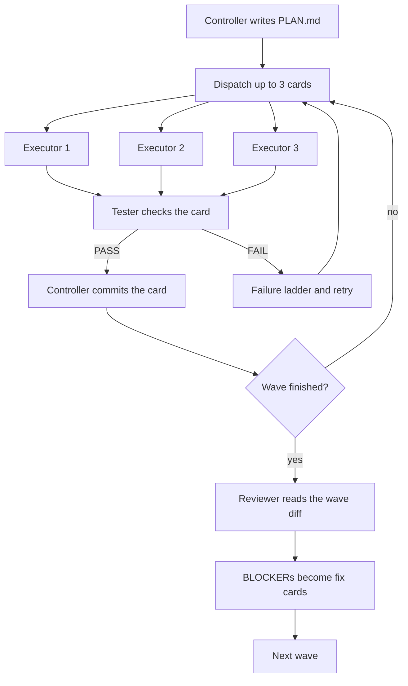
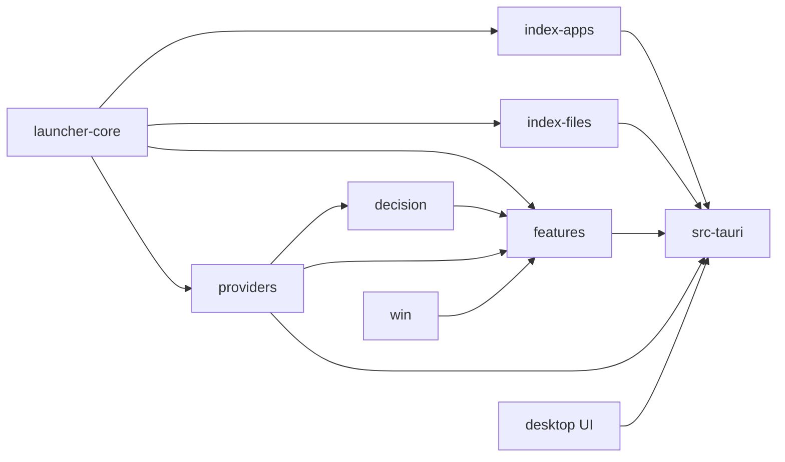
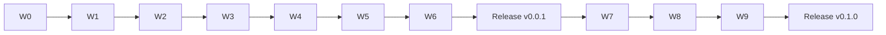

# Flick: Implementation Plan

| Field | Value |
|---|---|
| Document | 06-Implementation-Plan |
| Version | 1.0 |
| Date | 19 Oct 2026 |
| Owner | Akshit Bansal |
| Status | Draft |

## What this document is for

This plan shows how an AI team builds Flick in ten waves, W0 to W9, across two releases. It follows `KICKOFF.md` and does not change it. The requirement IDs (FR, NFR) come from `01-PRD.md`. It includes the 19 Oct security update (FR-SEC, ADR-011). The controller copies these cards into `.agent/PLAN.md` and refines them.

## Summary

- One controller, three executors, one tester and one reviewer build the product. Only the controller commits.
- Each wave has about 6 to 12 small task cards. Three run at the same time.
- One commit per card. The reviewer checks each wave. BLOCKER findings are fixed first in the next wave.
- Total effort is about 45 to 75 agent-hours. Usage limits decide the real calendar time.
- Secret safety is built in from W0 to W5: CI audits, write-only key commands, a strict CSP, log redaction and a mandatory key warning.
- Akshit does a short list of manual steps: installers, logins, keys and the Spotify developer app.

## 1. How the build runs

The team has five roles. Think of a kitchen: the controller is the head chef, who plans and decides but does not cook. Executors cook. The tester tastes every dish. The reviewer checks the whole menu at the end of each wave.

| Role | Count | Model | Does | Never does |
|---|---|---|---|---|
| Controller | 1 (this session) | session model | Writes `.agent/PLAN.md` and `LOG.md`, dispatches cards, commits, decides | Edits files under `apps/` or `crates/` |
| Executor | 3 | haiku, low effort (sonnet when the card says so) | Writes code, runs fast checks | Commits, runs heavy builds |
| Tester | 1 | haiku, low (sonnet if a failure needs more than 3 files) | Runs checks and heavy builds, one at a time | Edits source |
| Reviewer | 1 | opus, high | Reads the wave diff, reports BLOCKER, SHOULD-FIX, NIT | Edits anything |

**Rules that keep it safe**

- A card owns at most 6 source files, and two running cards never own the same file. W0 scaffolding cards may own more.
- Root manifests, lockfiles, the features registry file and the settings navigation file belong to one running card. Others report needs under NEEDS.
- Each wave starts with a small card `T<n>.0` that adds that wave's workspace dependencies. **Decision:** this card runs first on haiku, because it keeps executors from fighting over `Cargo.toml`.
- Failure ladder: attempt 1 on the card's model, attempt 2 with the tester's log, attempt 3 on sonnet or split the card. Then mark it blocked and move on.
- Models: haiku for docs, config, scaffolding and single-file work. Sonnet for multi-file cards, public APIs, `unsafe` or Win32 code, async streaming and any retry.
- Executors run only `cargo check -p`, `cargo test -p` and `pnpm --filter` checks. The tester runs heavy builds, one at a time, in one shared target directory.

## 2. Milestones

| Milestone | Waves | Tag | Exit condition |
|---|---|---|---|
| M1 Core | W0 to W6 | v0.0.1 | Core and F01 to F05 work, budgets measured, installer built, docs and site live |
| M2 Integrations | W7 to W9 | v0.1.0 | F06 to F10 work, per-feature benches pass, docs updated |

## 3. Waves and task cards

Columns: ID, title, owner (crate or folder the card may edit), model, dependencies, and the "done when" check. "Owner" paths are short for space. The controller writes the exact file list in each card.

### W0 Preflight and skeleton

| ID | Title | Owner | Model | Depends on | Done when |
|---|---|---|---|---|---|
| T0.1 | Toolchain check | none (read-only) | haiku | none | Versions printed for rustup (msvc target), MSVC Build Tools, WebView2, Node 20+, pnpm, git, gh, vercel, git-cliff. Install MSVC or WebView2 with winget if missing; if that needs admin, note it under Needs Akshit and continue |
| T0.2 | Rust workspace | `Cargo.toml`, `rust-toolchain.toml`, `crates/*` | haiku | T0.1 | Eight empty crates pass `cargo check -p <crate>` |
| T0.3 | JS workspace, Tauri app, Next.js app | `package.json`, `pnpm-workspace.yaml`, `biome.json`, `apps/*` | haiku | T0.1 | `pnpm install` works. Desktop typecheck passes. Web build passes. Tauri opens a blank hidden window |
| T0.4 | CI and repo files | `.github/workflows/ci.yml`, `cliff.toml`, `LICENSE`, `.gitignore`, `.editorconfig` | haiku | T0.1 | CI has the seven required steps. `git cliff` groups feat/, fix/, up/, rem/, sm/, add/, add-p/, hide/, init/. LICENSE is MIT, Akshit Bansal |
| T0.5 | Supply-chain checks in CI | `deny.toml`, `ci.yml` (audit steps) | haiku | T0.4 | CI runs cargo-deny, cargo-audit and `pnpm audit`. Lockfiles committed (FR-SEC-09) |
| T0.6 | First commit | controller, git | none | T0.2 to T0.5 | `cargo check --workspace` passes. One commit holds `CLAUDE.md`, `KICKOFF.md` and `.claude/`. `.agent/` is ignored |

**Decision:** T0.2 lists `apps/desktop/src-tauri` as a workspace member before T0.3 creates it, so the full workspace check runs only at T0.5.

### W1 Core crates and shell

| ID | Title | Owner | Model | Depends on | Done when |
|---|---|---|---|---|---|
| T1.0 | W1 dependencies | `Cargo.toml`, lockfile | haiku | T0.6 | `cargo metadata` passes |
| T1.1 | Core types, brand, Mode, prefix parsing | `launcher-core` (lib, brand, types, mode, prefix) | sonnet | T1.0 | Prefix tests for `>` `/` `?` pass. Brand name appears only in `brand.rs` |
| T1.2 | Matcher and ranking hooks | `launcher-core` (matcher, ranking, bench) | sonnet | T1.1 | Tests pass. Bench for 2,000 apps is 2 ms or less |
| T1.3 | SQLite store | `launcher-core` (store) | sonnet | T1.1 | Tests on a temp database pass. `spawn_blocking` is the documented call path |
| T1.4 | AppsFolder enumeration and filters | `index-apps` (enumerate, filter) | sonnet | T1.0 | Filter tests cover uninstall, readme, help, documentation, website, license, manual and folder targets |
| T1.5 | Launch, icons, cache | `index-apps` (launch, icons, cache) | sonnet | T1.4 | Normal, `runas` and reveal paths exist. Icons 32 and 64 px. Cache loads without enumeration |
| T1.6 | Window and global hotkey | `src-tauri` (main, window, hotkey) | sonnet | T1.0 | Window created once, hidden. 50 toggles log monotonic timestamps. Hides on blur |
| T1.7 | Tray, single instance, autostart | `src-tauri` (tray, autostart) | sonnet | T1.6 | Open, Settings, Quit work. A second launch focuses the first |

### W2 File index, providers, launcher UI

| ID | Title | Owner | Model | Depends on | Done when |
|---|---|---|---|---|---|
| T2.0 | W2 dependencies (includes `secrecy`, `zeroize`) | `Cargo.toml`, `package.json`, lockfiles | haiku | W1 | Installs resolve |
| T2.1 | Scan, skip rules, snapshot | `index-files` (scan, skip, snapshot) | sonnet | T2.0, T1.1 | Skip-rule tests pass. Snapshot round-trips |
| T2.2 | Watcher, query, bench | `index-files` (watch, query, bench) | sonnet | T2.1 | Bench over 300,000 synthetic paths is p95 25 ms or less |
| T2.3 | Provider trait and OpenAI-compatible client | `providers` (lib, openai_compat) | sonnet | T2.0 | Recorded SSE fixtures pass. Cancel aborts the request |
| T2.4 | Anthropic client | `providers` (anthropic) | sonnet | T2.3 | Current docs fetched first. Request fixture has no temperature, top_p, top_k or prefill |
| T2.5 | Presets, detection, fallback | `providers` (presets, detect, fallback) | sonnet | T2.3 | 200 ms probe tests pass. Detected servers are offered, none enabled. Fallback on error, 429, 5xx |
| T2.9 | Secret store and host binding | `providers` (secret, keys) | sonnet | T2.3 | `keyring` round trip. `SecretString` and `zeroize`, mask on format. Key sent only over HTTPS to its host (http for localhost). Redirects not followed. Host change clears the key (FR-SEC-01, 05, 06) |
| T2.10 | Log redaction and panic hook | `launcher-core` (redact, tests) | sonnet | T2.9 | Key patterns and stored values are masked in logs and panics (FR-SEC-07) |
| T2.6 | Tokens, fonts, keyboard reducer | `desktop/src` (tokens.css, brand.ts, fonts, reducer) | sonnet | T2.0 | Vitest reducer tests pass. No literal colors. Plex fonts bundled as woff2 |
| T2.7 | Strip layout, results, hint switcher | `desktop/src/launcher/*` | sonnet | T2.6 | Typecheck and lint pass. Matches the Design Lab at 44 px rows and 6 px/3 px corners |
| T2.8 | Find actions, Query view, Fast/Think | `desktop/src/query/*`, `launcher/Actions` | sonnet | T2.7 | Answer view grows to 60% of the monitor, then scrolls. With no provider it shows "Connect a model to ask questions" and a button |
| T2.11 | Safe Markdown renderer | `desktop/src/query/Markdown.tsx`, test | sonnet | T2.7 | Raw HTML off, no remote images, links open only on click. Test with `<script>` and `` (FR-SEC-04) |

### W3 Feature system, Windows wrappers, Tauri commands

| ID | Title | Owner | Model | Depends on | Done when |
|---|---|---|---|---|---|
| T3.0 | W3 dependencies | root manifests | haiku | W2 | Resolves |
| T3.1 | Feature trait, registry, schema | `features` (lib, registry, schema) | sonnet | T3.0, T1.1 | Registry starts and stops stubs. Schema renders to JSON |
| T3.2 | Lifecycle tests | `features/tests` | sonnet | T3.1 | A disabled feature holds no task, watcher or client |
| T3.3 | Power, session, recycle bin | `win` (lib, power, recycle) | sonnet | T3.0 | Calls compile. Every `unsafe` has a `// SAFETY:` comment |
| T3.4 | Explorer restart, radios | `win` (explorer, radios) | sonnet | T3.3 | Radio read works on this PC. Denied access returns an error, not a panic |
| T3.5 | Commands: search, launch, open, reveal, copy | `src-tauri/commands` (search, launch) | sonnet | T1.2, T1.5, T2.2 | Launch call returns in 30 ms or less |
| T3.6 | Command: ask_stream and cancel | `src-tauri/commands/ask.rs` | sonnet | T2.5, T2.9 | Tokens reach the UI over the Channel. Esc aborts. The key is read in Rust, never sent to the UI |
| T3.7 | Commands: feature toggle and options | `src-tauri/commands/features.rs` | sonnet | T3.1 | Toggle calls `start()` and `stop()` |
| T3.8 | Tauri CSP and capabilities | `tauri.conf.json`, `src-tauri/capabilities/*` | sonnet | T3.0 | CSP is `default-src 'self'`, `connect-src ipc:`. No shell, fs, http or opener plugin exposed. A WebView fetch fails (FR-SEC-03) |
| T3.9 | Write-only secret commands | `src-tauri/commands/secrets.rs` | sonnet | T2.9, T2.10 | `set`, `delete`, `test`, `status`. Status returns only `{present, last4, host, added_at, last_used}`. No command returns a secret (FR-SEC-02, 10) |

### W4 Features F01 to F05

| ID | Title | Owner | Model | Depends on | Done when |
|---|---|---|---|---|---|
| T4.0 | Registry entries and dependencies | features registry file, root manifests | haiku | W3 | Seven module stubs registered. fend-core and chrono-tz resolve |
| T4.1 | F01 Frecency | `features/src/frecency/` | sonnet | T4.0, T1.3 | FR-F01-01 to 03 tests pass. Off gives match order |
| T4.2 | F04 Web shortcuts | `features/src/web/` | sonnet | T4.0 | Six defaults. Encoding test passes |
| T4.3 | F02 Math and time zones | `features/src/math/` (mod, calc, zones) | sonnet | T4.0 | The three PRD examples return correct results offline |
| T4.4 | F02 ECB rate cache | `features/src/math/rates.rs` | sonnet | T4.3 | Fetch at most once a day, off the keystroke path. Offline shows age |
| T4.5 | F03 System commands | `features/src/syscmd/` | sonnet | T3.3, T3.4 | Double-Enter guard tests pass (3 s window) |
| T4.6 | F05 Project scan and markers | `features/src/projects/` (scan, markers) | sonnet | T4.0 | Fixture tree finds all five markers |
| T4.7 | F05 VS Code recents and editor | `features/src/projects/` (vscode, editor) | sonnet | T4.6 | State store path verified on this PC first. `code`, `term`, bare name work |

Each feature card also adds its criterion bench for `query()`. The target is 0.5 ms or less.

### W5 Settings, first run, performance

| ID | Title | Owner | Model | Depends on | Done when |
|---|---|---|---|---|---|
| T5.1 | Settings shell, nav, General | `desktop/src/settings` (App, Nav, General) | sonnet | T3.7 | Nav shows the on-count, for example 9/10 |
| T5.2 | Features page from schemas | `settings` (Features, SchemaForm) | sonnet | T5.1 | Toggle and Options work with no hand-written feature UI |
| T5.3 | AI providers page and About | `settings` (Providers, About) | sonnet | T5.1, T2.5 | Groups Local, Free gateways, Your own key. None preselected. Per key: status, last used, Test and Delete buttons |
| T5.4 | First run: hotkey and conflict | `desktop/src/firstrun` (Hotkey), `src-tauri` check | sonnet | T1.6 | A held Alt+Space is detected and another key is requested |
| T5.5 | First run: model detection, overlay | `firstrun` (Detect, Overlay) | sonnet | T5.4, T2.5 | Servers are detected and offered, none on. Overlay shows once |
| T5.9 | Add-key dialog with warning | `settings/AddKeyDialog.tsx`, test | sonnet | T5.3, T3.9 | Exact warning text with the host. Save disabled until the checkbox is ticked. Shown on every add or replace. Not shown for local providers (FR-SEC-12) |
| T5.10 | Security regression tests | `launcher-core/tests/secrets.rs`, `src-tauri/tests` | sonnet | T3.8, T3.9 | No secret in config, SQLite, logs, fixtures or command output. CSP string checked |
| T5.6 | Benches with all features on | `launcher-core/benches`, `features/benches` | sonnet | W4 | Command match 2 ms or less with F01 to F05 on |
| T5.7 | `measure.ps1` | `scripts/measure.ps1` | haiku | T1.6 | Prints p95 over 50 toggles |
| T5.8 | Fix budget misses, `performance.md` | owners named by the failing bench | sonnet | T5.6, T5.7 | Every NFR-01 to NFR-08 has a measured number |

### W6 Docs, site, release v0.0.1

| ID | Title | Owner | Model | Depends on | Done when |
|---|---|---|---|---|---|
| T6.1 | README | `README.md` | haiku | W5 | Covers FOSS-first, wrapper model, install, hotkeys, modes, features, local providers, privacy, residual key risk, SmartScreen note |
| T6.2 | Architecture | `docs/architecture.md` | haiku | W5 | Has a mermaid diagram |
| T6.3 | ADR-001 to ADR-005 | `docs/adr/` | haiku | none | Each has Context, Decision, Alternatives, Consequences |
| T6.4 | ADR-006 to ADR-011 (ADR-011 is secrets and keys) | `docs/adr/` | haiku | none | Same |
| T6.5 | CONTRIBUTING, SECURITY, roadmap | three files | haiku | none | Roadmap lists the later ideas |
| T6.6 | Landing page with live demo | `apps/web` (page, demo) | sonnet | W5 | Hero uses the same tokens. Download button points to the latest release |
| T6.7 | `/docs` and `/changelog` | `apps/web` (docs, changelog) | sonnet | T6.6 | Web build passes |
| T6.8 | `release.ps1` | `scripts/release.ps1` | sonnet | W5 | Sets versions, runs git-cliff, commits, tags |
| T6.9 | `release.yml` | `.github/workflows/release.yml` | sonnet | T6.8 | tauri-action builds NSIS and attaches a SHA-256 checksum |
| T6.10 | Whole-repo review | read-only | opus | T6.1 to T6.9 | Findings against KICKOFF and CLAUDE.md |
| T6.11 | Fix BLOCKERs | per finding | sonnet | T6.10 | Re-review of the fixes is clean |
| T6.12 | Cut v0.0.1 | controller | none | T6.11 | `release.ps1 0.0.1`, tag, push if gh is logged in |
| T6.13 | Deploy site | controller | none | T6.12 | Vercel production deploy if logged in |

### W7 Decision crate, Windows additions, settings pages

| ID | Title | Owner | Model | Depends on | Done when |
|---|---|---|---|---|---|
| T7.0 | W7 dependencies | root manifests | haiku | v0.0.1 | Resolves |
| T7.1 | NL parser (stage 1) | `decision` (parser, tests) | sonnet | T7.0 | 40+ phrase table test passes |
| T7.2 | `/v1/systemone` client | `decision` (systemone) | sonnet | T7.0 | `docs.typesafe.ai/api.md` and the Laya README fetched first. Fixtures pass |
| T7.3 | LLM picker | `decision` (picker) | sonnet | T7.2, T2.5 | Strict JSON parsing rejects bad replies |
| T7.4 | Media session (GSMTC) | `win` (media) | sonnet | T7.0 | Reads now-playing and sends controls |
| T7.5 | Port tables | `win` (ports) | sonnet | T7.0 | TCP and UDP listing finds a test listener |
| T7.6 | UI Automation selection with Ctrl+C fallback | `win` (uia, selection) | sonnet | T7.0 | Clipboard restored after fallback |
| T7.7 | Decision engine page | `settings/Decision.tsx`, nav file | sonnet | T7.2 | Only the parser is on. Laya, Kev, Your AI provider, Jev are off. Probe status and `laya-serve` note present |
| T7.8 | Integrations page | `settings/Integrations.tsx` | sonnet | T7.7, T5.9 | Spotify steps, YouTube, Obsidian, Notion, webhooks. Every secret goes through the add-key dialog |

### W8 Features F06 to F10

| ID | Title | Owner | Model | Depends on | Done when |
|---|---|---|---|---|---|
| T8.0 | Registry entries | registry file, root manifests | haiku | W7 | Five stubs registered |
| T8.1 | F06 Natural-language finder | `features/src/nlfind/` | sonnet | T7.1 to T7.3 | Works with all engines off. Engines get names and folders only |
| T8.2 | F07 Ports and `proc` | `features/src/ports/` | sonnet | T7.5 | Backspace kill needs a confirm |
| T8.3 | F08 Media base layer | `features/src/media/` (mod, gsmtc, links) | sonnet | T7.4 | `spotify:search:` and YouTube search open |
| T8.4 | F08 Spotify PKCE, YouTube key | `features/src/media/` (spotify, youtube) | sonnet | T8.3 | Fixture OAuth passes. Tokens in Credential Manager |
| T8.5 | F09 Explain this | `features/src/explain/` | sonnet | T7.6, T3.6 | Preview before send. Fake key is blocked |
| T8.6 | F10 Capture, local targets | `features/src/capture/` (parse, obsidian, markdown) | sonnet | T8.0 | `log 250 lunch` parsed offline. File gains a line. Secret-looking text is blocked (FR-SEC-08) |
| T8.7 | F10 Capture, Notion and webhook | `features/src/capture/` (notion, webhook) | sonnet | T8.6 | Recorded fixtures pass |

### W9 Release v0.1.0

| ID | Title | Owner | Model | Depends on | Done when |
|---|---|---|---|---|---|
| T9.1 | Per-feature benches | feature bench files | sonnet | W8 | All `query()` at 0.5 ms or less |
| T9.2 | Docs for F06 to F10 | `docs/`, `README.md` | haiku | W8 | Includes how to run `laya-serve` and make a Spotify developer app |
| T9.3 | Landing page features section | `apps/web` | sonnet | T9.2 | Ten features shown |
| T9.4 | Whole-repo review | read-only | opus | T9.1 to T9.3 | Findings list |
| T9.5 | Fix BLOCKERs | per finding | sonnet | T9.4 | Clean re-review |
| T9.6 | Cut v0.1.0 | controller | none | T9.5 | `release.ps1 0.1.0`, tag, push, deploy |

## 4. Dependency graph

Waves run in order. Inside a wave, cards run in parallel when the table allows it.

## 5. Definition of done

| Level | Done means |
|---|---|
| Card | Owned files only changed. Accept commands pass. Tester says PASS. Public items have doc comments. No `unwrap()` or `expect()` outside tests. Clippy clean with `-D warnings`. No brand name outside the brand files. No secret in code, logs or fixtures. One commit |
| Wave | Every card passed and committed. Reviewer ran. No open BLOCKER. SHOULD-FIX batched. NITs in `docs/followups.md`. Pushed if gh is logged in. Handoff rewritten |
| Release | Every FR for the release passes, including FR-SEC-01 to 12. NFR-01 to NFR-08 measured in `docs/performance.md`. Audits clean. Runs with no paid keys. CHANGELOG from git-cliff. Installer and checksum attached |

## 6. Testing plan per wave

| Wave | Tester runs | Live tests (`#[ignore]`) |
|---|---|---|
| W0 | `cargo check --workspace`, `pnpm install`, web build, `cargo deny check`, `cargo audit`, `pnpm audit` | none |
| W1 | `cargo test -p launcher-core -p index-apps`, bench, manual tray and hotkey smoke test | none |
| W2 | index-files bench, SSE fixture tests, `pnpm --filter desktop test` | `OLLAMA_URL`, `ANTHROPIC_API_KEY`, `OPENROUTER_API_KEY` |
| W3 | features lifecycle tests, `win` tests, CSP and capability checks, one `cargo build` of the app | none |
| W4 | Per-feature tests and `query()` benches | none (ECB uses a fixture) |
| W5 | Security regression tests, add-key dialog test, full `cargo test`, clippy, fmt, `pnpm lint`, `pnpm test`, `measure.ps1` | none |
| W6 | `pnpm --filter web build`, one `pnpm tauri build`, install the NSIS file on a clean user | none |
| W7 | Parser table test, systemone fixtures, `win` tests | `LAYA_URL`, `KEV_URL`, `TYPESAFE_API_KEY` |
| W8 | Fixture tests for Notion, Spotify, webhook; secret-block test | `NOTION_TOKEN` |
| W9 | All benches, full suite, free-only checklist run | all that are reachable |

Live tests never print a key. Everything else uses recorded fixtures.

## 7. Release checklist

**v0.0.1**

1. All W0 to W6 cards done or listed as blocked.
2. `cargo fmt --check`, `cargo clippy --all-targets -- -D warnings`, `cargo test`, `pnpm typecheck`, `pnpm lint`, `pnpm test` pass.
3. `docs/performance.md` has measured numbers for NFR-01 to NFR-08. Audits pass and the security tests (T5.10) pass.
4. Manual run: Spotify (Store) opens from `spo`. Hotkey conflict prompt works. Query falls back across two providers.
5. `./scripts/release.ps1 0.0.1` sets versions, writes the changelog, commits and tags.
6. GitHub repo created (private first), pushed, release workflow attaches the NSIS installer and SHA-256.
7. README shows the SmartScreen note and the residual key risk. Site deployed.

**v0.1.0**

1. Same checks 1 to 3, plus every `query()` at 0.5 ms or less.
2. Manual run with no paid keys: F06 to F10 each work. Explain this blocks a fake key. Media works on a browser tab.
3. Docs include `laya-serve` and the Spotify developer app steps.
4. `./scripts/release.ps1 0.1.0`, push, deploy.

## 8. Time estimate

An agent-hour is one agent working for one hour. Three executors in parallel use three agent-hours per wall-clock hour. These numbers are guesses. Real time depends on usage limits, because opus review and long sonnet cards use quota fast. Expect pauses when a limit window closes.

| Wave | Agent-hours | Wall-clock with 3 slots |
|---|---|---|
| W0 | 1 to 2 | 0.5 to 1 h |
| W1 | 4 to 7 | 2 to 3 h |
| W2 | 6 to 11 | 3 to 5 h |
| W3 | 5 to 8 | 2 to 3 h |
| W4 | 4 to 7 | 2 to 3 h |
| W5 | 6 to 10 | 3 to 4 h |
| W6 | 4 to 7 | 2 to 3 h |
| W7 | 5 to 8 | 2 to 3 h |
| W8 | 5 to 9 | 2 to 4 h |
| W9 | 3 to 5 | 1 to 2 h |
| Total | 45 to 77 | 20 to 33 h |

Failed cards and retries can add 20% to 40%.

## 9. Risks during the build

| Risk | What the controller does |
|---|---|
| Usage limit reached mid-wave | Finish the cards in flight, write state to `LOG.md`, pause, resume from `PLAN.md` statuses |
| A card fails three times | Mark blocked, keep building cards that do not depend on it, list it in the report |
| 24 GB RAM is full | One heavy build at a time. Tester only. Shared target directory. Pause executors if the machine swaps |
| Manifest conflicts | Wave-start card `T<n>.0` owns root manifests. NEEDS go into the next card |
| A key leaks into a fixture, log or snapshot | The controller greps staged files for key patterns before every commit. T5.10 scans the tree. Any hit blocks the commit |
| Haiku writes `unsafe` or async code badly | Cards with Win32, COM or streaming are sonnet. A haiku failure retries on sonnet |
| API docs differ from memory (Spotify, Anthropic, systemone, VS Code state store) | The card must fetch current docs first. The controller rejects work that guessed |
| Budget missed in W5 | T5.8 fixes it. If it cannot, record the number in docs/performance.md and the handoff, then release |
| Reviewer finds many BLOCKERs | Fix cards run first in the next wave. No new work starts until they pass |
| Live service missing | Live tests stay `#[ignore]`. Fixtures prove the code path |

## 10. What Akshit must do by hand

| When | Action |
|---|---|
| Before W0 | Install MSVC Build Tools and the WebView2 runtime if missing (otherwise those cards wait under Needs Akshit). Install Node 20+, pnpm, Rust, git |
| Before W0 | Run `gh auth login` and `vercel login` |
| After W0 | Approve creating `akshit-bansal11/flick`. Default is private. Make it public yourself |
| W6 | Approve the first Vercel deploy. Add `flick.akshitbansal.dev` in DNS later |
| Optional | Install Ollama and pull a small model (for example `ollama pull qwen3:4b`) so Query works free |
| W7 and later | Run `pip install laya` then `laya-serve` to test Laya. Kev is self-hosted the same way |
| W8 and later | Make a Spotify developer app on an account with Premium (since February 2026, 5 users per dev-mode app). Copy its client ID into Settings |
| Optional | Add keys for OpenRouter, Anthropic, TypeSafe (Jev), a Notion integration token and database ID, and an Obsidian vault folder. Make each key only for Flick and set a usage limit first, as the add-key dialog says |
| Each release | Install the unsigned installer once and click through SmartScreen. Run `measure.ps1` on your own PC |
